<div align="center">

# RATCHET

### An independent security control plane that reviews what an access change *makes possible* before it happens.

*Getting inside an organisation should not mean gaining control of the organisation.*

[](https://github.com/sakararya43-web/Ratchet/actions/workflows/ci.yml?query=branch%3Amain)
[](https://github.com/sakararya43-web/Ratchet/actions/workflows/core.yml?query=branch%3Amain)
[](https://sakararya43-web.github.io/Ratchet/)
[](go.mod)
[](web/package.json)
[](https://www.w3.org/TR/webauthn-3/)
[](https://datanova-2026-global-data-thon.devpost.com/)
[](https://datanova-2026-global-data-thon.devpost.com/)

**DataNova 2026 Global Data-Thon · Track: Cybersecurity and Fraud Detection**

### [Open the live demo &rarr;](https://sakararya43-web.github.io/Ratchet/)

A guided, clickable demo on a **fictional crypto exchange with mock data**. It runs entirely in your browser:<br>no sign-up, no server, nothing to install. To run RATCHET against your own data, [run it yourself](#run-it-yourself).

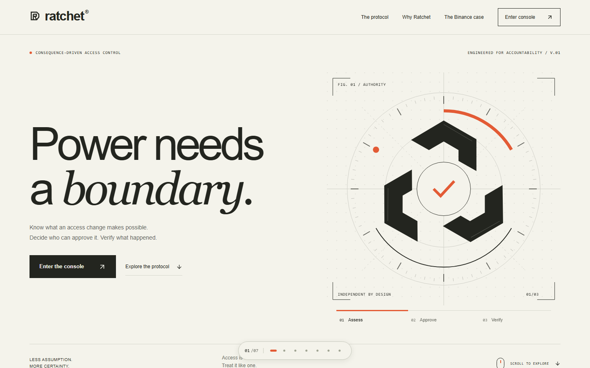

</div>

---

## Two ways to run RATCHET

The same console runs in two modes. It picks one automatically when it loads.

| | **Hosted demo** | **Run it yourself** |
|---|---|---|
| **Open** | [sakararya43-web.github.io/Ratchet](https://sakararya43-web.github.io/Ratchet/) | `https://localhost:8444` on your machine |
| **Data** | Northwind Exchange: a small, **fictional** organisation with mock records | Your organisation, read from the target by the connector and stored in PostgreSQL |
| **Backend** | None. An in-browser stand-in answers the same API with the same permission rules | Go control-plane core, graph service, connector, NATS JetStream, PostgreSQL |
| **Sign-in** | Pick one of four personas | Real accounts issued by the operator |
| **Passkeys** | Simulated prompt, clearly labelled | Real WebAuthn: Windows Hello, Touch ID or a security key |
| **Audit chain** | Real SHA-256 hash chain, re-verified in your browser | Real, persisted, and verifiable offline with `ratchetctl` |
| **State** | Lives in your browser tab. *Reset* or a reload restores the start | Persistent. Nothing is erased |
| **Setup** | None | Docker and Python, then one command |

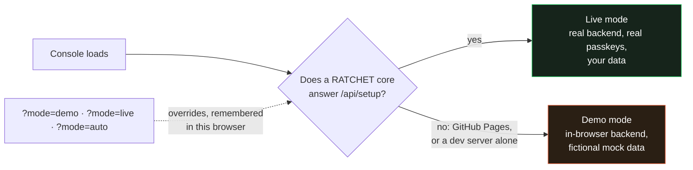

> **Everything in the hosted demo is fictional.** Northwind Exchange, its people and its records are made up for this demonstration, and a "Demo data · fictional exchange" label stays on screen the whole time.

---

## Why RATCHET

Organisations invest heavily in the front door: SSO, MFA, hardware keys and zero-trust networking. Breaches still happen through **valid** sessions: a stolen token, a compromised developer laptop, an over-privileged CI account or a manipulated insider. Once inside, the damage comes from what happens next:

1. **Quiet privilege expansion.** The attacker requests or grants a role that looks harmless.
2. **Safeguard erosion.** The rules that would catch them, such as withdrawal limits, two-person rules and audit logging, are weakened.
3. **Reaching the crown jewels.** A chain of ordinary-looking permissions leads to a tier-0 asset such as a wallet signer or customer database.

Traditional IAM and PAM ask *"is this person allowed to request this role?"* If the attacker controls an authorised account, the answer is always yes.

RATCHET asks a different question: **"what would this change make reachable, who must independently approve that, and did the target actually end up in that state?"**

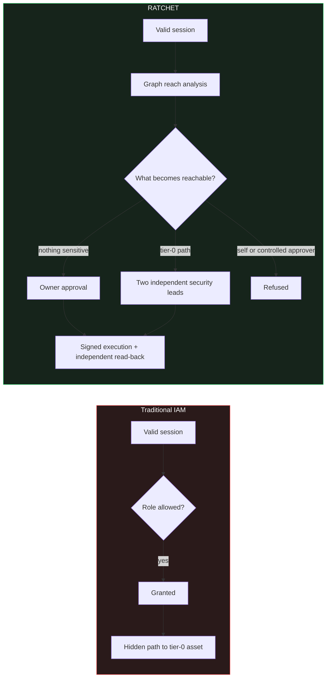

Two principles shape the design:

- **Consequence over identity.** Decisions come from the authorisation graph *after* the proposed change, not from the requester's title.
- **Asymmetric access.** Granting power is slow and governed, while taking power away should be fast and safe. RATCHET classifies a change as a *reduction* only when graph analysis proves it. A change is never treated as a reduction just because the requester says so.

---

## The Binance case: why RATCHET exists

RATCHET is built around the attack path described in [Binance's initial incident report](https://www.binance.com/fr-AF/blog/community/3229153443759566763) (3 Nov 2026). The front door wasn't the failure. The damage came from what one compromised foothold could reach.

According to the report:

1. **Entry: a developer device.** Social engineering, malicious downloads and compromised internal tooling put an attacker inside the developer environment.
2. **Leverage: a deployment credential.** From there the attacker obtained a deployment credential, an ordinary-looking piece of access.
3. **Critical reach: wallet signing.** That credential led to wallet infrastructure. Unauthorised signing enabled transfers *outside* the normal withdrawal flow.
4. **Persistence.** On-chain delegations survived the withdrawal suspension and had to be revoked separately.

The lesson: withdrawal controls were not the whole boundary. What mattered was the **path** from a developer device to a signer, and nothing reviewed what each step of that path made possible.

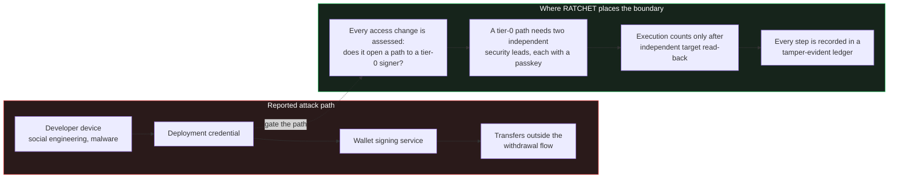

Both ways of running RATCHET recreate this shape on a simulated crypto exchange:

- **The hosted demo** follows Rahul, a finance analyst whose laptop session is taken over. The session tries to weaken the withdrawal rule, then asks for exchange-admin rights. RATCHET rejects the first request, sends the second to two independent security leads, and contains the session with a minimum-disruption cut. [Walk through it below.](#the-hosted-demo)
- **The local prototype** starts a compromised low-privilege account (`user:rahul-assistant`) that tries to gain the `wallet-operator` role. RATCHET shows the **two new paths to the tier-0 wallet signer**, refuses self-approval, and grants the role only after two independent security leads approve that exact change, with real passkeys and real HTTP probes. [Walk through it below.](#local-prototype-walkthrough)

> The incident motivates the design. Both demos use a simulated exchange, and neither claims that RATCHET would have prevented the Binance incident.

---

## The four pillars

RATCHET is built around four core capabilities. Each one has its own workspace in the console.

### 1. Independent Security Authority

The rules that protect critical systems decide who may create an administrator, change access to a critical system, change an approval rule or weaken a safeguard. Those rules are governed by a **separate authority**, not by the production systems they protect. A policy bundle or approver registry changes only when the **current** M-of-N quorum signs it, so a compromised production account cannot rewrite the protections that are supposed to constrain it.

The **Security policy** workspace reads the active rules straight from the signed policy bundle the core verified. It shows them in the order they are evaluated, with the resource owners they name:

<p align="center">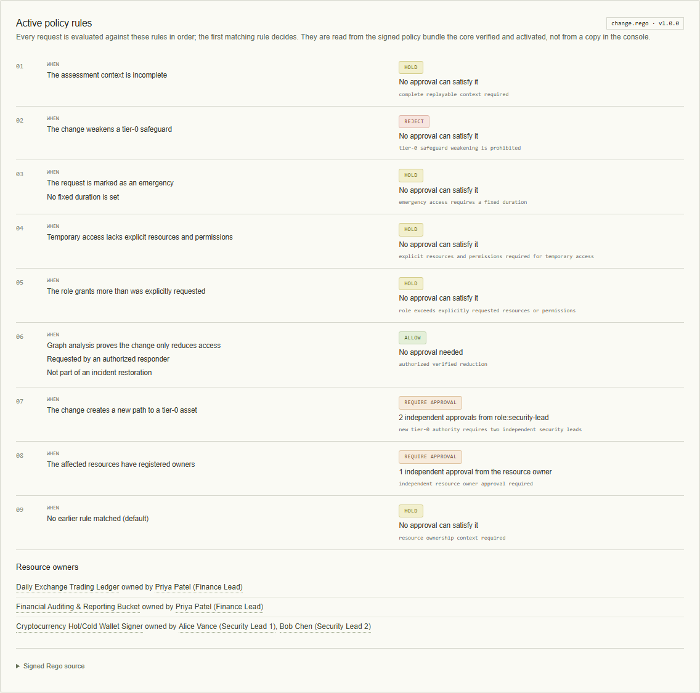</p>

Alongside the rules, it shows the Authority behind them: its members, the 2-of-2 quorum, the active bundle with its hash and both signatures.

<p align="center">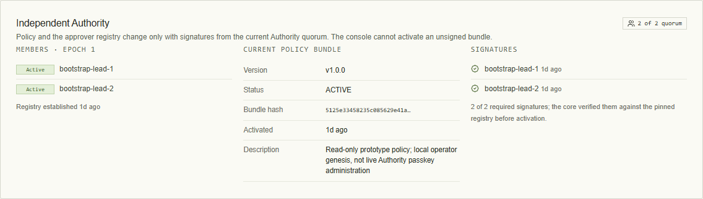</p>

### 2. Permission Change Review

Every request to increase or alter access is treated as a decision that deserves review. It covers who is asking, what they already have, what they want, why, and what the change would enable. The signed policy then decides:

| Outcome | When |
|---|---|
| **Allow** | Graph analysis proves the change only reduces access |
| **Require independent approval** | The change is legitimate but too sensitive to approve alone, for example one resource owner, or two security leads for any new tier-0 path |
| **Hold** | More context is needed, or the situation changed after submission |
| **Reject** | The change is not allowed, for example weakening a tier-0 safeguard |

A requester can never approve their own escalation, and every approval is bound by passkey to the exact change digest. The **Changes** workspace lists every request with its decision and status. Selecting one opens the change inspector beside the table:

<p align="center">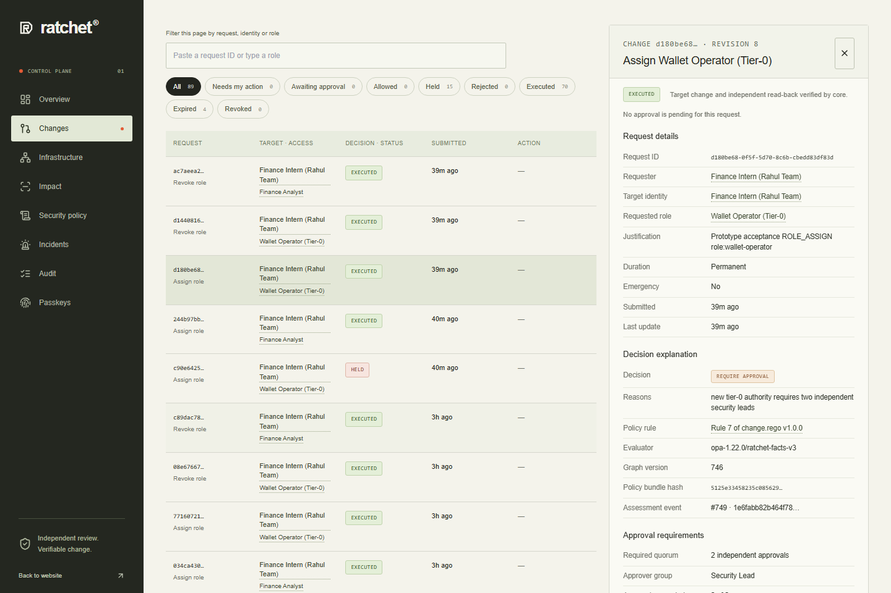</p>

### 3. Impact and Blast-Radius Review

Before a sensitive change is accepted, RATCHET shows what it would actually do: which resources become reachable, whether a new route to a tier-0 asset appears, which identities could be taken over, which safeguards weaken and how the blast radius changes in each criticality tier. A reviewer never has to guess what a powerful permission means.

The **Impact** workspace simulates a draft change without submitting anything. Below, granting the wallet role to the finance intern is flagged as an escalation: the tier-0 blast radius grows, the wallet signer becomes reachable, and both new critical paths are drawn with the proposed edge highlighted.

<p align="center">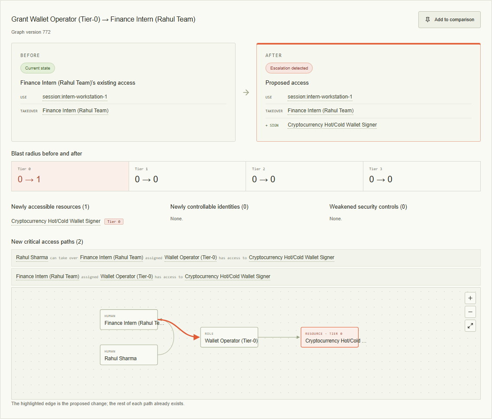</p>

The **Infrastructure** workspace explains *why*. The access graph can be focused on any entity, traced to tier-0 assets and searched by category. Any identity, role or resource opens in a shared inspector with its access, relationships, safeguards and related changes.

| Relationship graph around the tier-0 wallet signer | Entity inspector |
|:---:|:---:|
| 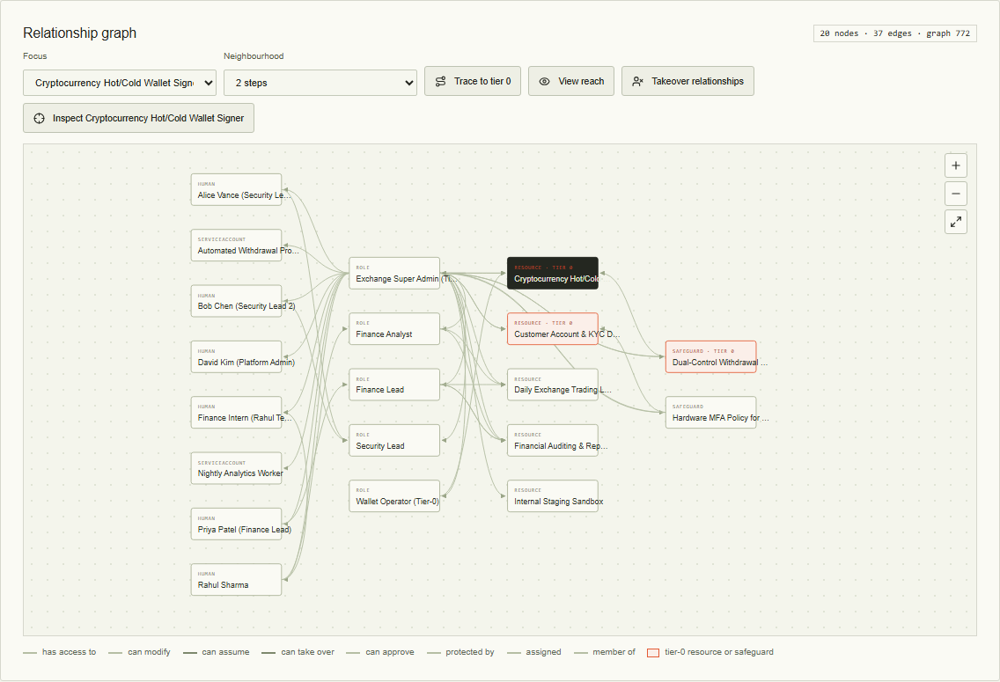 | 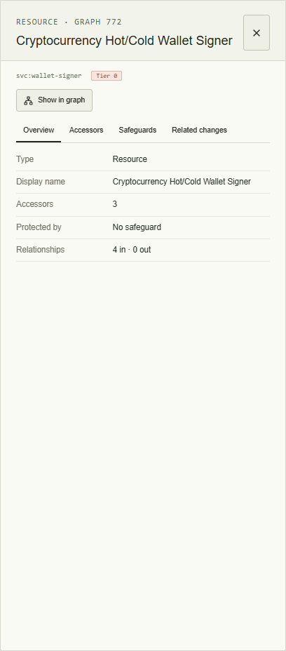 |

### 4. Emergency Containment

When an account, service or permission is believed to be compromised, taking power away must be faster than granting it. RATCHET computes a **minimum-disruption cut**: the smallest set of revocations, session terminations or account restrictions that removes every route to a tier-0 asset while keeping unrelated, legitimate work running. The **Incidents** workspace shows each proposed action with its reason, alongside a business-continuity view of what keeps working and what is isolated. A responder confirms the exact plan with a passkey before it runs on the priority path.

```mermaid
flowchart LR
    A["Compromised identity"] --> B["Every route to a tier-0 asset"]
    B --> C["Minimum-disruption cut<br/>smallest set of revocations"]
    C --> D["Business continuity<br/>what keeps working · what is isolated"]
    D --> E["Responder confirms the exact plan<br/>with a passkey"]
    E --> F["Priority execution<br/>and target read-back"]
    F --> G["Incident record<br/>in the audit ledger"]
    G --> H["Restoration only through a<br/>fresh, independently reviewed request"]
    style C fill:#16241b,stroke:#22c55e,color:#fff
    style E fill:#1e1b4b,stroke:#818cf8,color:#fff
```

Containment is accountable: it records who initiated the response, what was restricted and why, and what must happen before normal access is restored.

---

## Capabilities

The landing page walks through the eight console workspaces as you scroll. Most of them can be tried in the [hosted demo](#the-hosted-demo); the target probes, Kubernetes and offline verification need the [local backend](#run-it-yourself).

<p align="center">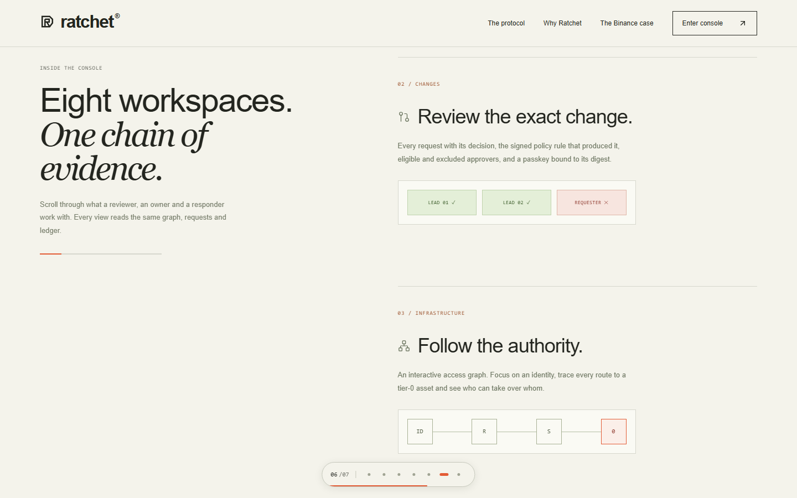</p>

| Capability | Where to see it |
|---|---|
| Consequence assessment: newly reachable resources, tier-0 paths, changed powers, weakened safeguards, blast radius per tier | Changes inspector · Impact |
| Independent approval with passkeys (WebAuthn). The browser verifies the exact canonical envelope before signing. | Changes › *Review and approve* |
| Self-approval, duplicate approval and insufficient quorum refused (owner quorum 1, tier-0 quorum 2) | Changes inspector (eligible and excluded approvers) · Local prototype walkthrough |
| Every decision explained by the signed policy rule that produced it, with graph version and policy bundle hash | Changes inspector · Security policy |
| Signed commands to the target plus independent read-back before `EXECUTED` | Changes timeline · real HTTP probes change between 403 and 200 |
| Interactive access graph: focus, neighbourhoods, tier-0 tracing, reach and takeover relationships | Infrastructure |
| Tamper-evident, hash-linked audit ledger, re-verified end to end in the browser | Audit › *Verify audit chain* |
| Reviewed revocation that restores the starting access | Local prototype walkthrough |
| Restricted, server-redacted views for requesters and owners | Every workspace |
| Independent Authority: M-of-N governed policy and approver registry | Security policy |
| Minimum-disruption containment with business continuity, and typed restoration through fresh review | Incidents |
| Temporary-access expiry and drift-watch correction | Changes (duration and expiry status) |
| Kubernetes RBAC adapter and fail-closed admission webhook | `internal/connector/k8s`, `cmd/ratchet-k8s-webhook` |
| Offline audit-chain and proof-bundle verification | `ratchetctl audit verify` |
| Guided, zero-install demo on fictional data, with persona switching and reset | [Hosted demo](https://sakararya43-web.github.io/Ratchet/) |

---

## How it works

Every access change follows the same path: **assess → approve → execute → verify → record**.

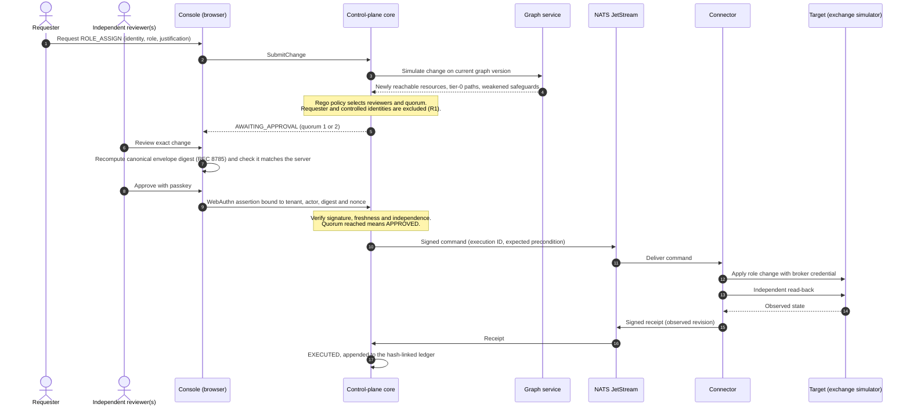

### Change lifecycle

The state machine lives in [`internal/domain/change.go`](internal/domain/change.go). It is pure and deterministic, and it never skips verification.

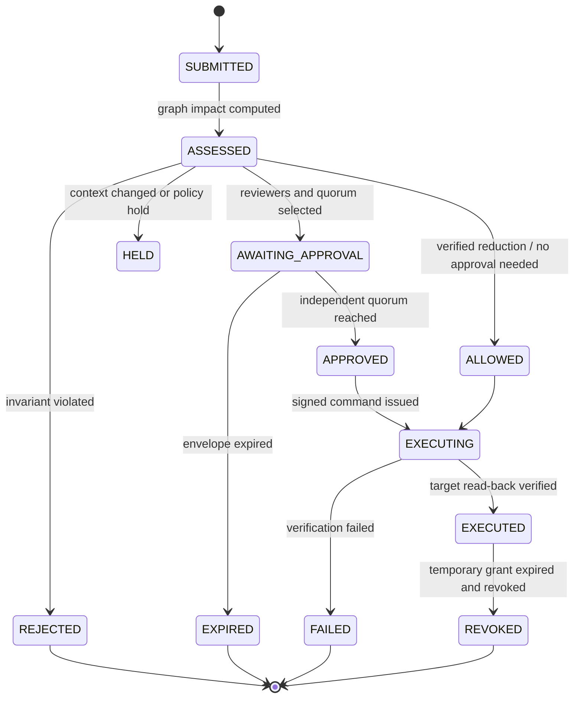

### What the reviewer actually signs

A passkey approval cannot be replayed against a different change, a different reviewer or a stale graph. The challenge binds all of them together:

```text
challenge = SHA-256( "RATCHET_APPROVAL_V1:" ‖ tenant ‖ actor ‖ change_digest ‖ nonce )
change_digest = SHA-256( RFC 8785 canonical JSON of the exact approval envelope )
```

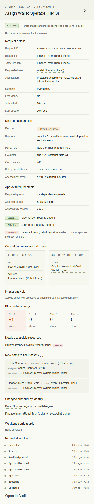

The browser recomputes `change_digest` independently, in TypeScript and with the same golden test vectors as the Go backend, before it asks the authenticator to sign. If the server shows one change and signs another, the browser refuses.

The change inspector shows everything bound into that digest for a real tier-0 request:

- the decision and the policy rule that produced it, here rule 7 of the signed `change.rego`;
- the graph version and policy bundle hash it was assessed against;
- who may approve, and who is excluded, starting with the requester;
- the access the change adds and its new tier-0 paths;
- the ledger events from submission to verified execution.

<br clear="right">

### Tamper-evident audit ledger

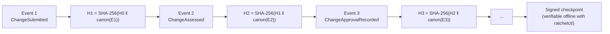

Changing, removing or reordering any event breaks every later hash. `ratchetctl audit verify --expected-tip=<hex>` also detects a ledger that has been cut short.

The **Audit** workspace does the same check in the browser. *Verify audit chain* exports the canonical bytes of every event, recomputes each hash, and compares the end of the chain with the server's snapshot:

<p align="center">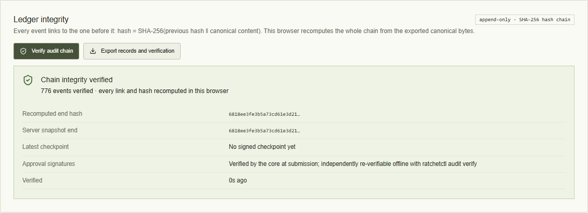</p>

---

## Architecture

### Runtime: the local prototype

The prototype runs as hardened containers: read-only root filesystems, all Linux capabilities dropped, `no-new-privileges`, a non-root user and pinned image digests. Only two ports are published, and both bind to `127.0.0.1`.

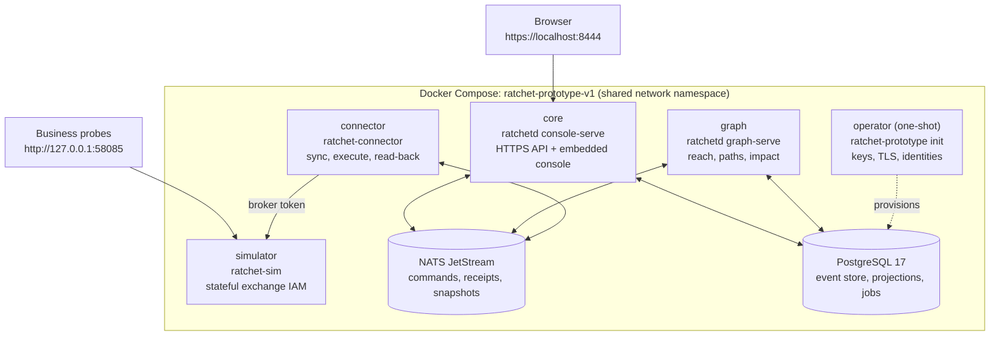

The **`completion-a`** profile ([`deploy/completion-a.compose.yaml`](deploy/completion-a.compose.yaml)) adds the standalone **Independent Authority** (`ratchet-authority`) with its own PostgreSQL, an enrollment-only server and M-of-N governed policy and registry rotation.

### Logical components

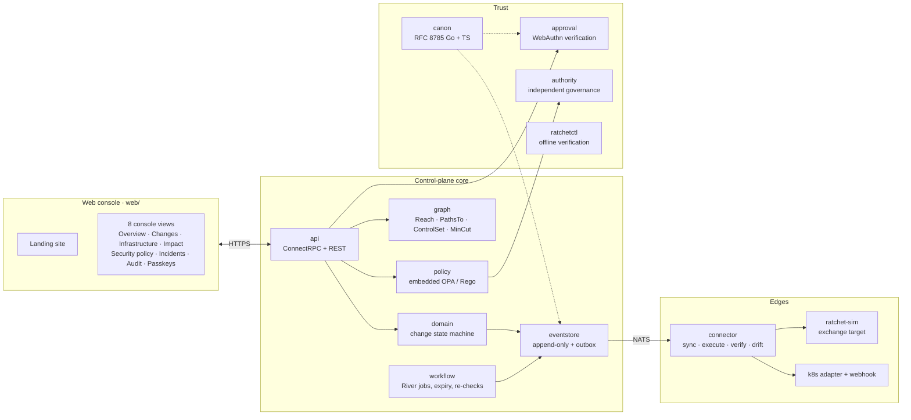

The two halves of the codebase meet only through typed contracts in [`proto/ratchet/v1/`](proto/ratchet/v1/) and [`internal/ports/`](internal/ports/).

---

## Security invariants

These rules are enforced in code across the control plane.

| ID | Invariant | What it means |
|---|---|---|
| **R1** | No self-escalation | Nobody approves an expansion of their own reach, or the reach of anyone in their control set. |
| **R2** | Reductions are computed, not claimed | A change counts as a reduction only if graph analysis proves no identity gains reach and no safeguard weakens. |
| **R3** | Approve exactly what you saw | Approvals bind to the canonical digest of the exact envelope. If the context goes stale, the change is re-assessed. |
| **R4** | Rules are independently governed | Policy, approver registry and thresholds change only by an M-of-N quorum of the *current* epoch. |
| **R5** | Nothing is erased | Every decision and observation is appended to a hash chain. |
| **R6** | Fail closed for escalation, open for reduction | When degraded, targets refuse privilege increases while revocations stay executable. |
| **R7** | Explainable decisions | Decisions come from Rego policy and deterministic graph reach. There are no opaque risk scores. |
| **R8** | Minimum-disruption containment | Containment cuts paths to tier-0 assets while preserving unrelated access. |
| **R9** | Proportional visibility | Requesters and owners get server-redacted views. Organisation-wide visibility requires policy authorisation. |

R9 in practice: the requester account can submit and assess its own changes, but organisation-wide records such as Audit, Incidents and Security policy are refused by the core, and the console says so plainly.

<p align="center">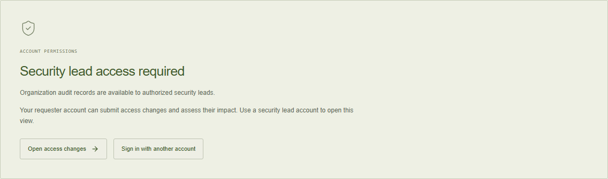</p>

---

## The hosted demo

**[sakararya43-web.github.io/Ratchet](https://sakararya43-web.github.io/Ratchet/)** is the real console, published as a static site. With no RATCHET core behind it, the console switches to an in-browser stand-in that answers every API call over a small mock dataset, so every workspace and every button works.

### Northwind Exchange: the fictional organisation

The dataset is deliberately small: enough to show each feature once, nothing more. It contains:

- 6 people and 2 service accounts;
- 6 roles;
- 6 resources and 2 safeguards, each with a criticality tier;
- 7 access requests, one for each outcome;
- 2 incidents.

Choose who to sign in as; each persona sees only what RATCHET allows them to see.

| Persona | Role in the story | What they see |
|---|---|---|
| **Rahul Sharma** | Finance analyst, the requester whose session is compromised | Own view: own requests, own impact. Policy, incidents and audit are refused |
| **Priya Patel** | Finance lead, owner of the finance resources | Own view, plus requests that need a resource owner |
| **Alice Vance** | Security lead 1 and incident responder | The whole organisation |
| **Bob Chen** | Security lead 2, the second independent approval for tier-0 changes | The whole organisation |

<p align="center">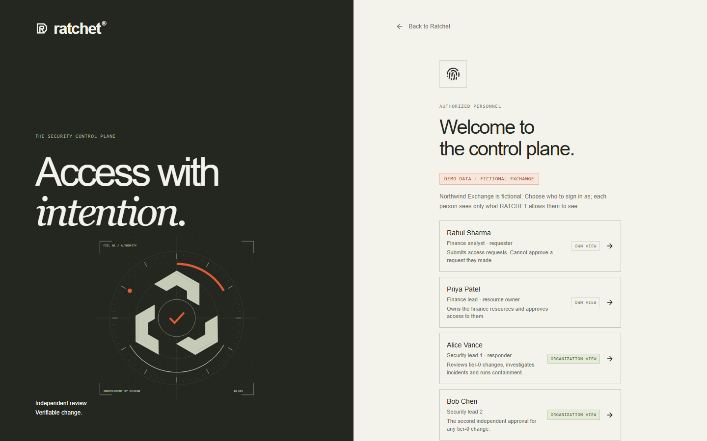</p>

The seeded requests cover every decision the signed policy can reach:

| Request | Outcome | Why |
|---|---|---|
| `req-1001` Rahul → Wallet Operator, 48 hours | Executed, expiry scheduled | Two security leads approved a reviewed month-end grant |
| `req-1002` Meera → Finance Lead | Expired | Nobody approved it in time |
| `req-1003` Meera → Staging Developer, 1 hour | Revoked | The temporary grant ended on schedule |
| `req-1004` Alice revokes David's staging access | Executed without approval | Graph analysis proved it only reduces access |
| `req-1005` David → Finance Lead, emergency | Held | Emergency access needs a fixed duration |
| `req-1006` Rahul weakens the withdrawal rule | Rejected | Weakening a tier-0 safeguard is prohibited |
| `req-1007` Rahul → Exchange Administrator | Awaiting approval | New tier-0 power needs two independent security leads |

### The guided tour

Entering the console from the landing page starts an 11-step tour of one story, Rahul's compromised session, across every workspace. Each step signs in as the right persona and opens the right record; the actions are yours to take. Reopen it any time from **Guided tour** in the top bar, and use **Reset** to start over.

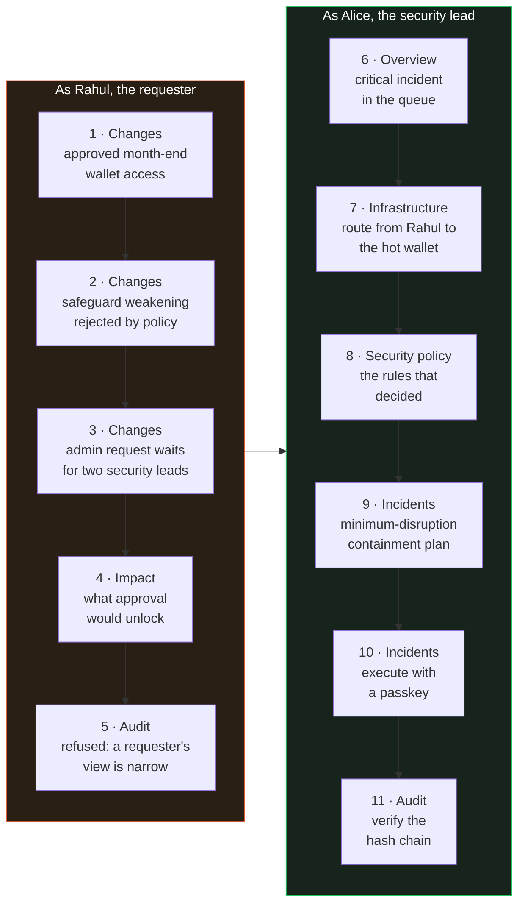

<p align="center">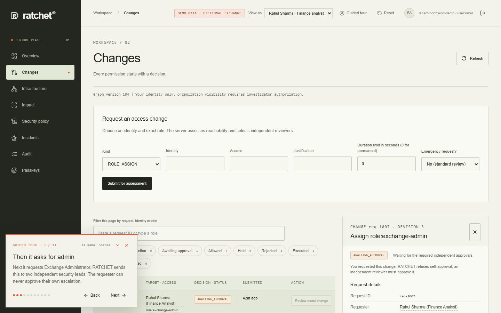</p>

At step 9, RATCHET computes the cheapest set of revocations that cuts every route from Rahul to a tier-0 asset: end the laptop session and revoke Wallet Operator. The business-continuity view shows that finance reports and everyone else's work keep running, while only wallet signing is isolated. Executing the plan puts Rahul's pending admin request on hold.

| Minimum-disruption containment | Passkey confirmation (simulated in the demo) |
|:---:|:---:|
| 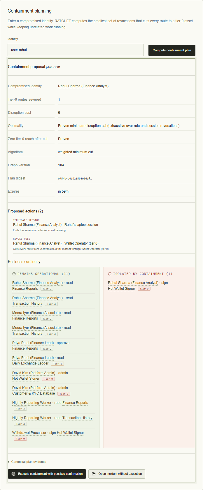 | 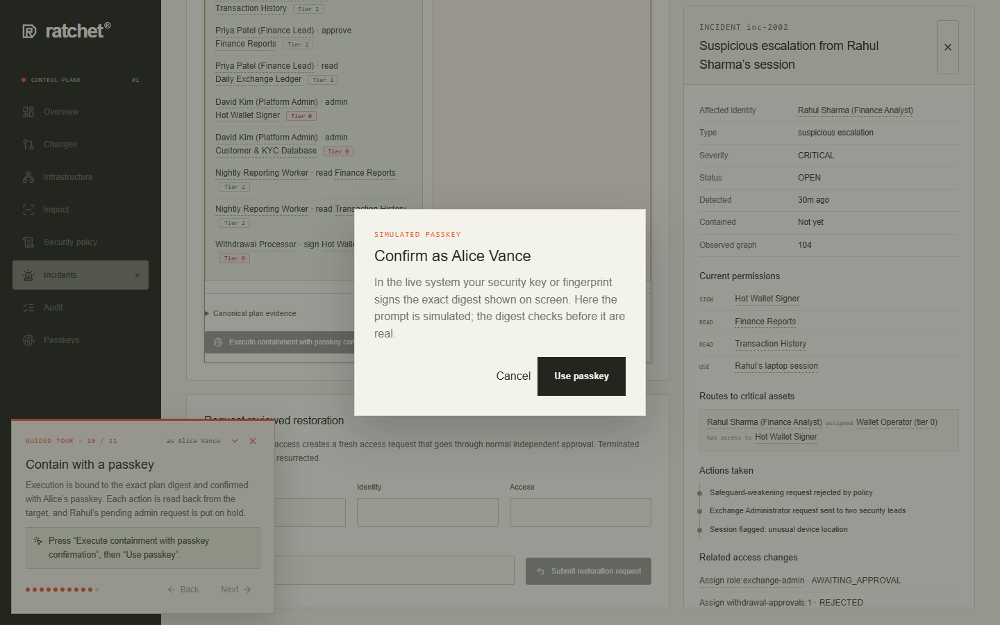 |

### What is real in the demo, and what is simulated

The demo runs the production console code unchanged. Only the server and the authenticator are replaced.

| Real: the same code as the live console | Simulated: stands in for the server |
|---|---|
| Every workspace, inspector, filter and chart | The core's API, answered from memory in your browser tab |
| Policy rules, read from the project's actual [`policies/change.rego`](policies/change.rego) | The decision itself, computed by a TypeScript mirror of that rule chain |
| Approval envelopes and RFC 8785 digests, checked by the browser before any passkey prompt | The passkey prompt: a labelled dialog instead of your authenticator |
| The SHA-256 audit hash chain, recomputed link by link by *Verify audit chain* | Target execution and read-back: the demo connector reports success |
| Permission rules: requesters are refused organisation-wide views, self-approval and duplicate approval are refused | Times are relative to when you open the page |

The demo code lives in [`web/src/demo/`](web/src/demo/). Add `?mode=live` to force the real backend, `?mode=demo` to force the demo, or `?mode=auto` to go back to automatic detection.

---

## Run it yourself

Run RATCHET on your own machine when you want the real backend: persistent state, real passkeys, real execution against a target, and your own data. There are three levels.

| Level | You get | You need |
|---|---|---|
| **1. Console only** | The demo above, served locally, for UI work | Node.js |
| **2. Full prototype** | Every service, real WebAuthn passkeys, a real ledger in PostgreSQL, a stateful exchange target with HTTP probes | Docker and Python |
| **3. Your own data** | The prototype analysing *your* organisation instead of the sample exchange | Level 2, plus a model of your organisation |

### 1. Console only (demo mode, no Docker)

```bash
cd web
npm ci
npm run dev        # http://localhost:3000, opens in demo mode because no core is running
```

### 2. The full prototype (live mode)

#### Prerequisites

| Tool | Version | Used for |
|---|---|---|
| Docker (with Compose v2) | recent | Builds and runs everything. Go is **not** needed on the host. |
| Python | 3.11+ | Launcher scripts |
| Node.js | 20+ | Console development and browser tests (optional) |
| Browser with a platform authenticator | — | Passkey approvals (Windows Hello, Touch ID or a security key) |

#### Start it

```bash
git clone https://github.com/sakararya43-web/Ratchet.git
cd Ratchet

# Build images, provision keys/TLS/identities, start every service
python scripts/prototype.py start
```

On first start, the launcher generates random database and broker secrets, creates a local certificate authority, provisions four demo identities and waits for every service to report healthy. Private material is written to `.local/prototype/`, which is gitignored:

| File | Contents |
|---|---|
| `.local/prototype/users.json` | Sign-in passwords and one-use passkey enrollment tickets for the four demo accounts |
| `.local/prototype/ca.pem` | Public certificate of the local HTTPS authority |

1. **Trust the local HTTPS certificate.** Import `.local/prototype/ca.pem` into your OS or browser trust store. Certificate checks stay on, because passkeys need a secure origin.
2. Open **https://localhost:8444** and sign in with an account from `users.json`.
3. Under **Passkeys**, register a passkey for each reviewer with its one-use enrollment ticket. Run `python scripts/prototype.py invite --actor <actor>` to issue a fresh ticket.

<p align="center">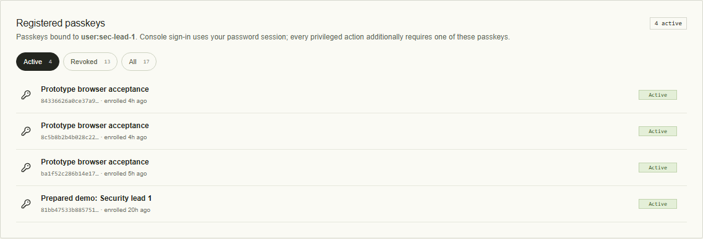</p>

The [prototype runbook](docs/ishaan/prototype-runbook.md) covers credential management, restarts and recovery in detail.

#### Useful commands

```bash
python scripts/prototype.py status                          # container status
python scripts/prototype.py restart --no-build              # restart services, keep identities, ledger and target state
python scripts/prototype.py stop                            # stop containers, keep volumes
python scripts/prototype.py credentials                     # re-export users.json and ca.pem
python scripts/prototype.py invite --actor user:sec-lead-1  # one-use passkey enrollment ticket
python scripts/prototype.py renew-tls                       # rotate the local TLS certificate
```

Real target probes (403 before a grant, 200 after verified execution):

```bash
curl -s -o /dev/null -w "%{http_code}\n" -X POST http://127.0.0.1:58085/api/v1/business/finance-report/read \
  -H "Content-Type: application/json" -d '{"session_id":"session:intern-workstation-1"}'
curl -s -o /dev/null -w "%{http_code}\n" -X POST http://127.0.0.1:58085/api/v1/business/wallet/sign \
  -H "Content-Type: application/json" -d '{"session_id":"session:intern-workstation-1","amount_usd":100}'
```

Working on the console against the running prototype? Rebuild the embedded assets with `python scripts/core-web-build.py`, then `python scripts/prototype.py restart`. The Vite dev server on its own always runs in demo mode, because passkeys and sessions live on the core's HTTPS origin.

### 3. Bring your own data

In live mode, RATCHET does not ship its own picture of your organisation. The **connector** reads identities, roles, grants and sessions from the target system, and the core builds its authorisation graph from that snapshot. Every analysis, decision and containment plan then runs on your data, and every change is executed and read back at the target.

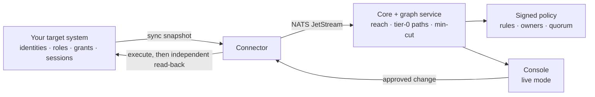

| To model | Where |
|---|---|
| **Your organisation in the simulator**: people, service accounts, sessions, roles, grants, and resources with their criticality tier | [`cmd/ratchet-sim/domain/seed.go`](cmd/ratchet-sim/domain/seed.go). The seed is used on a fresh deployment, see below |
| **Who approves what**: resource owners, security leads, quorum | The signed policy bundle and approver registry, changed only through the Independent Authority ([`policies/`](policies/), `ratchetctl`) |
| **A real Kubernetes cluster**: RBAC roles and bindings, with a fail-closed admission webhook | The Kubernetes adapter in [`internal/connector/k8s/`](internal/connector/k8s/) and [`cmd/ratchet-k8s-webhook`](cmd/ratchet-k8s-webhook/) |
| **Another identity system** such as AWS IAM, Entra ID, Okta or GitHub | Implement the connector contract (sync, execute, read-back) in [`internal/connector/`](internal/connector/). These connectors are on the [roadmap](#roadmap) |

The simulator writes its state on first start and keeps it, and the ledger never forgets the old organisation. A new seed therefore needs a fresh deployment, which **permanently deletes** the prototype's ledger, identities and target state. Keep the identities that sign in to the console (listed in `users.json`), or provision matching accounts with the operator tool:

```bash
python scripts/prototype.py stop
docker compose --env-file .local/prototype/prototype.env -f deploy/prototype.compose.yaml down -v   # deletes the volumes
python scripts/prototype.py start                # rebuilds images with your seed
```

> Keep real credentials out of the repository. The prototype writes every secret to `.local/`, which is gitignored.

---

## Local prototype walkthrough

This is the four-account journey on the full prototype, with real passkeys and real target probes. Every account starts on the **Overview**. Its metrics and attention queue (held requests, pending approvals and active incidents, each with its reason and age) open straight into the record that needs attention:

<p align="center">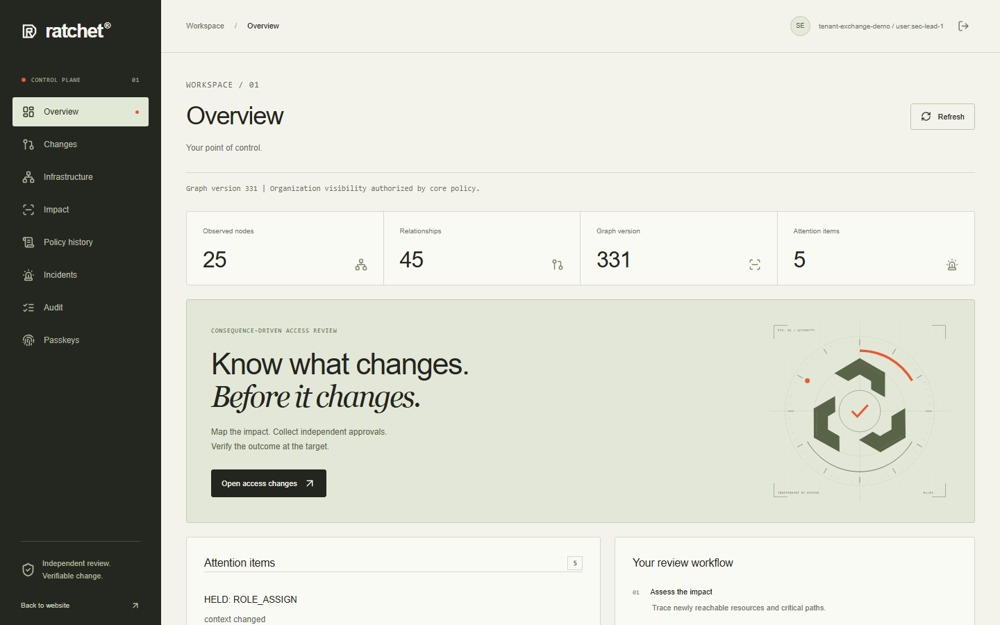</p>

The demo uses four independent accounts in the tenant `tenant-exchange-demo`:

| Account | Role in the story |
|---|---|
| `user:rahul-assistant` | Requester: starts with **no** finance or wallet access |
| `user:finance-lead` | Resource owner for finance resources |
| `user:sec-lead-1`, `user:sec-lead-2` | Independent security leads, both required for tier-0 access |

```mermaid
flowchart LR
    A["Start<br/>finance 403 · wallet 403"] --> B["Request finance-analyst"]
    B --> C["Self-approval refused"]
    C --> D["Finance owner approves<br/>finance 200"]
    D --> E["Request wallet-operator<br/>2 new tier-0 paths"]
    E --> F["Lead 1 approves<br/>1 of 2, wallet still 403"]
    F --> G["Lead 1 again: duplicate refused"]
    G --> H["Lead 2 approves<br/>wallet 200"]
    H --> I["Audit trail shows both approvals"]
    I --> J["Reviewed revocations<br/>finance 403 · wallet 403"]
```

1. **Requester** submits `ROLE_ASSIGN` → `role:finance-analyst`. The request reaches `AWAITING_APPROVAL`. The requester's own approval attempt returns **403**.
2. **Finance owner** opens *Review exact change*, checks the two newly reachable tier-2 resources and the verified digest, then approves with a passkey. After independent read-back, the finance probe returns **200**.
3. **Requester** submits `ROLE_ASSIGN` → `role:wallet-operator`. The assessment shows **2 new tier-0 paths**, which requires two security leads.
4. **Security lead 1** approves. The record shows 1 of 2 approvals and wallet signing still returns **403**. A second approval from the same lead is refused.
5. **Security lead 2** approves. The change executes, read-back is verified and wallet signing returns **200**.
6. **Audit** shows both approval events and the execution, each with its own hash in the chain.
7. Reviewed **ROLE_REVOKE** requests return both probes to **403**. Nothing is reset: the ledger, identities and trust root stay intact.

The step-by-step guide is in [`docs/ishaan/prototype-walkthrough.md`](docs/ishaan/prototype-walkthrough.md). PR [#2](https://github.com/sakararya43-web/Ratchet/pull/2) added a timed presenter script and a four-window presenter launcher (`python scripts/demo.py present`). The launcher uses virtual CTAP2 authenticators with real backend signature verification.

---

## Testing and quality

```bash
# Go: build, vet, unit + scenario tests (runs fine inside the golang:1.27.3 image)
go build ./... && go vet ./... && go test -count=1 ./...

# Console: types, unit tests, production build
cd web && npx tsc --noEmit && npm test && npm run build

# Full browser acceptance against the running prototype (real passkey ceremonies)
python scripts/prototype-browser.py
```

| Suite | What it covers |
|---|---|
| **Unit and property tests** | State machine, graph reach and min-cut, Rego decisions, canonical JSON, WebAuthn verification, event store and outbox |
| **Attack scenarios** ([`e2e/scenarios/`](e2e/scenarios/)) | Self-approval, controlled-approver refusal, safeguard edit versus governed amendment, containment of a compromised identity |
| **Cross-language golden vectors** ([`testdata/canon/`](testdata/canon/)) | Go and TypeScript produce byte-identical canonical JSON and digests |
| **Integration** (build tags `integration`, `peerintegration`) | PostgreSQL event store, Authority database, crash and restart recovery, the full attack families |
| **Browser acceptance** ([`web/e2e/`](web/e2e/)) | Four-account approval journey and Authority flows over real HTTPS |
| **Hosted CI** | [CI](.github/workflows/ci.yml) and [Core phase checks](.github/workflows/core.yml) on every push to `main`, including the built-image browser journey on Linux |
| **Demo site** | [Demo site](.github/workflows/pages.yml) type-checks and builds the console with a relative base, then deploys it to GitHub Pages on every push to `main` that touches the console or policies |

The badges at the top show live CI status. They are the authoritative signal for the current commit.

---

## Repository layout

```text
Ratchet/
├── cmd/
│   ├── ratchetd/              # Control-plane core: console API, graph service, enrollment, recovery
│   ├── ratchet-prototype/     # Operator tool: init, TLS, identities, invites, health
│   ├── ratchet-authority/     # Standalone Independent Authority service
│   ├── ratchet-connector/     # Outbound connector runtime
│   ├── ratchet-sim/           # Stateful simulated crypto exchange (target)
│   ├── ratchet-k8s-webhook/   # Kubernetes validating admission webhook
│   └── ratchetctl/            # CLI: genesis, policy/registry governance, offline audit verify
├── internal/
│   ├── domain/                # Pure change state machine and invariants
│   ├── graph/                 # Reach, PathsTo, ControlSet, impact, min-cut containment
│   ├── policy/                # Embedded OPA engine and bundle verification
│   ├── workflow/              # River jobs: execution, expiry, containment, incidents
│   ├── eventstore/  bus/      # Append-only store, outbox, NATS relay
│   ├── api/                   # ConnectRPC and REST handlers, sessions, privacy redaction
│   ├── approval/              # WebAuthn registration and assertion verification
│   ├── authority/  trust/     # Independent governance, genesis, checkpoints
│   ├── canon/  audit/  ledger/# RFC 8785 canonical JSON, hash chain, verification
│   ├── connector/             # Sync, execute, read-back, drift (+ k8s/, sim/ adapters)
│   └── webassets/             # Production console embedded into the Go binary
├── web/                       # React 19 + Vite console and landing site
│   └── src/demo/              # Hosted demo: dataset, graph engine, in-browser API, tour
├── policies/                  # Rego authorisation and change policies (+ tests)
├── proto/ratchet/v1/          # ConnectRPC / protobuf contracts
├── e2e/scenarios/             # Attack-scenario acceptance tests
├── deploy/                    # Dockerfiles and Compose profiles (prototype, completion-a, core)
├── scripts/                   # Launchers, acceptance runners, demo presenter
├── testdata/                  # Golden vectors, seed organisation, fixtures
└── docs/                      # Runbooks, evidence, design notes, screenshots
```

---

## Tech stack

| Area | Technology |
|---|---|
| Backend | **Go 1.27**, ConnectRPC 1.19, pgx 5, River 0.51 (jobs), goose (migrations) |
| Policy | **Open Policy Agent** 1.22 (embedded Rego) |
| Messaging | **NATS JetStream** 2.11 |
| Storage | **PostgreSQL 17** with separate migrator, runtime and projector roles |
| Identity | **WebAuthn** passkeys (go-webauthn 0.18), domain-separated challenges |
| Canonicalisation | **RFC 8785** JSON Canonicalization Scheme in Go and TypeScript |
| Frontend | **React 19**, TypeScript 5.7, Vite 6, Tailwind CSS 3.4, Lucide icons |
| Testing | Go testing + `rapid` property tests, Node test runner, Playwright |
| Packaging | Multi-stage Docker builds, digest-pinned bases, read-only non-root containers |

All dependencies are free and open source. The project uses no paid services.

---

## Known limits

We'd rather state these limits up front than have reviewers find them:

- **Single-host demonstration.** All services share one machine. Running them as separate processes with separate keys is not isolation from that machine's administrator. In production, the Independent Authority belongs on separately administered infrastructure.
- **Virtual authenticators in automation.** Automated browser runs use Chromium's virtual CTAP2 authenticators. Signature verification is real, but this does not certify physical hardware keys. Manual use works with platform authenticators such as Windows Hello or Touch ID.
- **Simulated target.** `ratchet-sim` models a crypto exchange's IAM. It is a security demonstration target, not a real financial system.
- **The hosted demo is a simulation.** It runs the real console, but decisions come from a TypeScript mirror of the signed policy, passkeys are a labelled dialog, and target execution is assumed rather than read back. Its state lives in your browser tab and resets on reload. It shows *what RATCHET does*; the local prototype shows *that it does it*.
- **The live backend is localhost only, for now.** The prototype's passkey relying-party ID and TLS certificate are issued for `localhost`. A public live deployment needs the [roadmap](#roadmap) work below.
- **Break-glass during a full control-plane outage** (PRD FR-X6) is specified but deferred. Revocations take priority over grants, but a multi-party emergency path for total loss of the control plane is future work.
- **Ledger truncation.** Offline verification proves events weren't modified or reordered. To detect a ledger that has been cut short, supply an expected tip or a signed checkpoint.

---

## Roadmap

Already delivered: the landing site and console redesign, the interactive graph explorer, and a public hosted demo with a guided tour and one-click reset. What comes next:

```mermaid
flowchart LR
    subgraph Now["Next: a public live backend"]
        N1["Configurable origin<br/>and passkey RP ID"]
        N2["Hosted live prototype<br/>free VM + Cloudflare Tunnel + Access"]
        N3["Ledger-preserving reset<br/>for the live prototype"]
    end
    subgraph Next["Then: complete the story"]
        X1["Containment acceptance<br/>exact-plan retries, residual-reach proof"]
        X2["Restoration acceptance<br/>typed flows with fresh review"]
        X3["Live Authority ceremony<br/>member rotation in the browser"]
        X4["Load your own organisation<br/>from a file, without code"]
    end
    subgraph Later["Later: towards production"]
        L1["Real connectors<br/>AWS IAM · Entra ID · Okta · GitHub"]
        L2["Kubernetes enforcement<br/>parity with the simulator journey"]
        L3["Break-glass quorum (FR-X6)"]
        L4["Physically separated Authority<br/>HSM / hardware-key signers"]
        L5["Witnessed checkpoints<br/>external transparency log"]
    end
    Now --> Next --> Later
```

| Horizon | Item | Why it matters |
|---|---|---|
| **Next** | Configurable origin and RP ID, hosted live prototype behind Cloudflare Access | Lets reviewers use the real backend and real passkeys, not only the demo |
| | Ledger-preserving reset for the live prototype | Repeatable live demos without weakening the "nothing is erased" rule |
| **Then** | Containment and restoration acceptance | Turns the wired min-cut execution and restoration flows into an end-to-end, verified journey on the live backend |
| | Live Authority ceremony in the browser | Member addition, removal and credential rotation under the current quorum |
| | Organisation import from a file | Try RATCHET on your own organisation without editing the simulator seed |
| **Later** | Cloud and identity-provider connectors | The connector contract already separates targets. Each new target needs sync, execute and read-back |
| | Break-glass, separated Authority, external witnesses | Closes the remaining gaps in the trust model for production use |
| | Multi-tenant operations, metrics and SIEM export | Operational readiness for real security teams |

---

## Team

| | |
|---|---|
| **Hackathon** | [DataNova 2026 Global Data-Thon](https://datanova-2026-global-data-thon.devpost.com/) |
| **Track** | Cybersecurity and Fraud Detection |
| **Problem statement** | Attackers with one valid session or compromised device quietly escalate privileges, weaken safeguards and reach crown-jewel assets, as in the Binance wallet-signing breach, because IAM checks *who* asks, not *what* a change makes reachable. |
| **Solution** | RATCHET, an independent control plane that maps what every access change would unlock, requires independent passkey approval for dangerous paths, verifies execution at the target and records everything in a tamper-evident ledger. |
| **Ishaan Sharma** · [@ishaans04](https://github.com/ishaans04) | Control-plane core: domain model, event store, graph analysis, policy, workflow, console API |
| **Sakar Arya** · [@sakararya43-web](https://github.com/sakararya43-web) | Trust and edges: canonical JSON, passkeys, Independent Authority, connectors, simulator, Kubernetes |

---

## Further documentation

| Document | Purpose |
|---|---|
| [Prototype walkthrough](docs/ishaan/prototype-walkthrough.md) | Four-account demo, step by step |
| [Prototype runbook](docs/ishaan/prototype-runbook.md) | Build, start, trust TLS, manage credentials |
| [Prototype acceptance](docs/ishaan/prototype-acceptance.md) | Recorded acceptance results and retained scope |
| [Hosted demo](https://sakararya43-web.github.io/Ratchet/) · [demo source](web/src/demo/) | The guided demo on fictional mock data, and the code behind it |
| [PR #2: demo-ready redesign](https://github.com/sakararya43-web/Ratchet/pull/2) | Landing site, console redesign, presenter script and UI design notes |
| [Security hardening](docs/security_hardening.md) · [Trust limits](docs/trust_limits.md) | Threat model boundaries and container hardening |
| [Architecture](RATCHET_Architecture.md) · [PRD](PRD.md) · [Idea document](RATCHET_Full_Idea_Document.md) | Full specification |
| [Changelog](CHANGELOG.md) | Engineering history |
