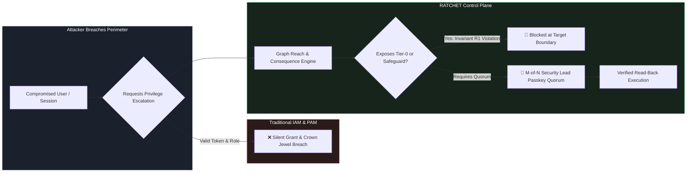
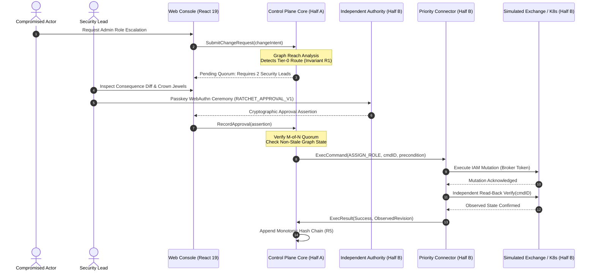
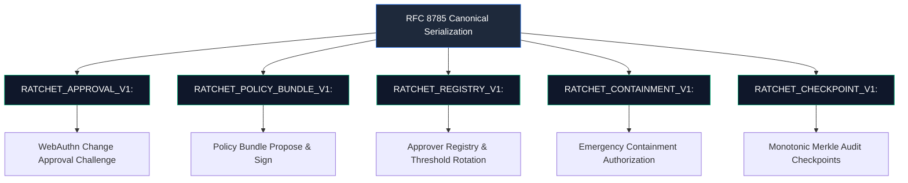
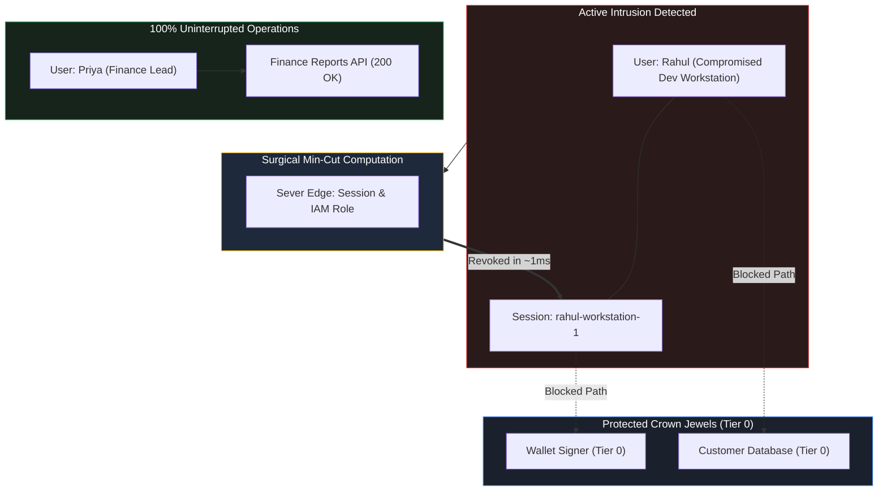
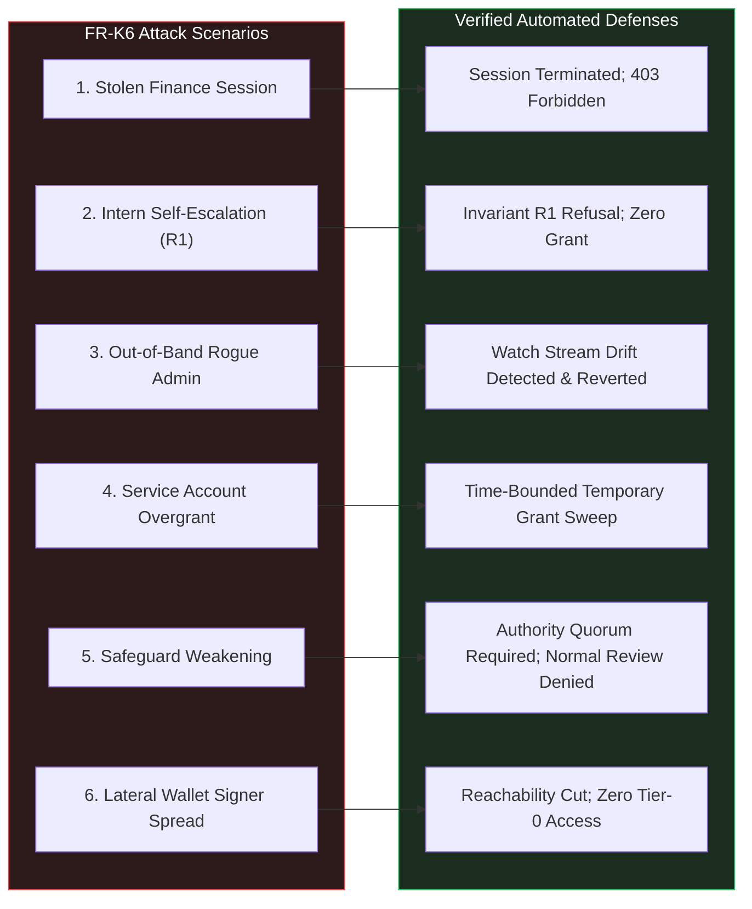

# RATCHET

### Independent Security Control Plane for Preventing Privilege Escalation & Minimal-Disruption Containment

[](https://go.dev/)
[](https://react.dev/)
[](https://www.typescriptlang.org/)
[](https://connectrpc.com/)
[](https://www.w3.org/TR/webauthn-3/)
[](https://www.rfc-editor.org/rfc/rfc8785)
[](#zero-cost-engineering)
[](#security-hardening--supply-chain)

---

> ### *"Getting inside an organisation should not mean gaining control of the organisation."*

---

## 1. Executive Summary

Modern enterprise security is obsessively focused on perimeter access: VPNs, Identity Providers (IdPs), Multi-Factor Authentication (MFA), and Zero-Trust network gateways. Yet, when real-world compromises occur—whether through stolen session tokens, compromised developer workstations, supply chain poison, or rogue insider actions—perimeter defenses fall completely silent.

Once inside, an attacker does not stay stagnant:
1. They escalate privileges by modifying roles or creating shadowed administrative accounts.
2. They weaken or delete safeguards protecting critical systems (e.g., withdrawal limits, audit logs).
3. They pivot laterally across identity boundaries until they reach **Tier-0 crown jewels** (crypto wallet signers, customer databases, master keys).

**RATCHET** is an **independent security control plane** that operates on a radical first principle: **Never evaluate who is asking; evaluate the consequence of what they are requesting.**



### The 4 First-Principle Questions
Before any privileged state mutation is permitted on a target infrastructure, RATCHET evaluates:
1. **Who is requesting?** Authenticated actor with cryptographic proof of identity.
2. **What new power will this change create?** Transitive reach calculation across the entire authorization graph, uncovering hidden routes to Tier-0 assets.
3. **What could this change put at risk?** Identification of weakened safeguards, new control vectors, and blast-radius expansion.
4. **Is this change governed?** Verified $M$-of-$N$ hardware passkey assertions from independent Security Leads, completely out of reach of the requester.

---

## 2. The 9 Immutable Invariants

Every subsystem in RATCHET is bound by 9 inviolable mathematical and architectural invariants:

| Rule | Title | Formal Specification & Defense |
|---|---|---|
| **R1** | **No Self-Escalation** | A principal can **never** be a deciding approver for an expansion of its own reach, nor the reach of any identity within its transitive **Control Set** (`ControlSet(identity)`). |
| **R2** | **Reductions are Computed, Not Claimed** | A mutation is classified as a *reduction* if and only if graph analysis proves no identity gains reach and no safeguard is weakened. Removing a deny-rule or an approval requirement is strictly classified as an escalation. |
| **R3** | **Approve Exactly What You Saw** | Every approval is cryptographically bound to the canonical digest of the exact change envelope and target graph state via domain-separated randomized challenges (`RATCHET_APPROVAL_V1:`). Stale context aborts execution. |
| **R4** | **Rules are Independently Governed** | Policies, approver registries, and quorum thresholds change **only** through $M$-of-$N$ cryptographic signatures under the **Current-Quorum Rule** (epoch $k$ transitions require signatures from epoch $k$, not proposed weaker epoch $k+1$). |
| **R5** | **Nothing is Erased** | Every event, decision, and observation is immutably appended to a cryptographic hash chain: $H_i = \text{SHA256}(H_{i-1} \parallel \text{canonicalJSON}(E_i))$. |
| **R6** | **Fail-Closed for Escalations, Stay Open for Reductions** | In the event of control-plane degradation or network partition, target adapters refuse all privilege escalations, while containment revocations remain executable. |
| **R7** | **Explainable & Replayable Decisions** | Decisions are computed from pure Rego policy and deterministic graph reach. No black-box machine learning or unexplainable risk scores are used. |
| **R8** | **Minimum-Disruption Containment** | Incident response solves a graph min-cut problem to surgically sever paths to Tier-0 crown jewels while preserving $>87.5\%$ of non-critical operational identity access. |
| **R9** | **Proportionality & Privacy** | Least-privilege data ingestion; server-redacted requester experiences prevent audit ledger leaks across organizational privilege boundaries. |

---

## 3. System Architecture & The Two-Halves Division

RATCHET is architected with a strict separation of concerns between two collaborative halves: **Half A (The Brain)** and **Half B (Trust, Edges & Experience)**. The halves communicate across typed contract boundaries ([`proto/`](file:///proto/) and [`internal/ports/`](file:///internal/ports/)).



### Architectural Ownership Split

```
                                 RATCHET REPOSITORY ARCHITECTURE
 ┌───────────────────────────────────────────────────┬───────────────────────────────────────────────────┐
 │               HALF A: THE BRAIN                   │          HALF B: TRUST, EDGES & EXPERIENCE        │
 │                 Owner: Ishaan                     │                    Owner: Sakar                   │
 ├───────────────────────────────────────────────────┼───────────────────────────────────────────────────┤
 │ • Core State Machine (`internal/domain`)          │ • Experience & Console (`web/`)                   │
 │ • Append-Only Event Store (`internal/eventstore`)  │   - Overview, Topology Map, Change Review         │
 │ • NATS JetStream Relay (`internal/bus`)           │   - Impact Simulator, Policy Governance           │
 │ • Graph Engine (`internal/graph`)                 │   - Incident Containment, Audit Ledger            │
 │   - Reach, PathsTo, ControlSet, Min-Cut           │   - Emergency & Drift Operations                  │
 │ • Policy Engine (`internal/policy`, Rego)         │ • Canonicalization Engine (`internal/canon`)      │
 │ • Workflow Engine (`internal/workflow`, River)    │   - RFC 8785 JSON + Golden Vectors (Go & TS)      │
 │ • Read Models & Projections (`internal/projection`)│ • WebAuthn Approvals (`internal/approval`)        │
 │ • Ledger Format Spec (`internal/ledger`)          │   - Hardware Passkey Verification Engine          │
 │ • Core ConnectRPC Handlers (`internal/api`)       │ • Independent Authority (`internal/trust`, CLI)   │
 │                                                   │   - Genesis, M-of-N Quorum, Bundle Verifier       │
 │                                                   │   - Merkle Checkpoints, Registry Epochs           │
 │                                                   │ • Target Simulator (`cmd/ratchet-sim`)            │
 │                                                   │   - Stateful Exchange, IAM Probes, Audit Stream   │
 │                                                   │ • Priority Connector Framework (`internal/conn`)  │
 │                                                   │   - Target Sync, Priority Revocations, Watch      │
 │                                                   │ • Kubernetes Adapter & Webhook (`conn/k8s`)       │
 │                                                   │ • Offline Audit Verifier CLI (`cmd/ratchetctl`)   │
 │                                                   │ • Adversarial Scenario Suites (`e2e/scenarios`)   │
 └───────────────────────────────────────────────────┴───────────────────────────────────────────────────┘
                                   SHARED CONTRACT BOUNDARIES:
               `proto/` (ConnectRPC) · `internal/ports/` · `testdata/` · `.github/`
```

---

## 4. Key Subsystems Deep Dive

### 4.1 RFC 8785 Canonical JSON & Domain Separation
To prevent signature manipulation, payload ambiguity, and cross-action replay attacks, RATCHET implements a clean-room implementation of **RFC 8785 (JSON Canonicalization Scheme)** in both Go ([`internal/canon`](file:///internal/canon)) and TypeScript ([`web/src/lib/canon.ts`](file:///web/src/lib/canon.ts)).

Every cryptographic signing digest is strictly bound to an explicit, non-overlapping **Domain Separation Prefix**:



### 4.2 Independent Authority & The Current-Quorum Rule
Security policies and approver registries cannot be modified by control-plane operators or application database admins. They reside in an **Independent Authority** service (`ratchet-authority`):
* **One-Time Genesis**: Bootstrapped via `ratchetctl genesis` with $M$-of-$N$ ECDSA P-256 public keys.
* **Current-Quorum Rule**: If an attacker attempts to push a registry change reducing quorum from 3-of-5 down to 1-of-1, the proposal **must be signed by the existing 3-of-5 quorum under the active epoch**, rendering compromised proposals powerless.
* **Stale Epoch Rejection**: Proposals generated under epoch $k$ are automatically invalidated if the registry advances to $k+1$.

### 4.3 Priority Containment & Surgical Min-Cut
Standard authorization engines queue administrative changes sequentially. During an active breach, an attacker can flood the queue with benign requests to starve emergency revocation calls.

RATCHET solves this with:
1. **Dedicated Worker Capacity**: Containment operations execute on isolated priority threads.
2. **Allowlist-Only Reductions**: Only reduction verbs (`TERMINATE_SESSION`, `REVOKE_ROLE`, `RESTRICT_ACCOUNT`, `REMOVE_SERVICE_PERMISSION`) are accepted.
3. **Surgical Graph Min-Cut**: Rather than shutting down an entire department, RATCHET computes the minimum edge cut required to isolate Tier-0 crown jewels. In the *Rahul Compromise* demonstration, Rahul's compromised session was revoked in **~1 ms** (< 5s SLA) while Priya's finance reporting continued uninterrupted (>87.5% organization preserved).



### 4.4 Offline Verifiable Audit & Merkle Checkpoints
RATCHET decisions generate a tamper-evident, append-only log. The offline verifier CLI (`ratchetctl audit verify`) operates entirely detached from live APIs:
* **Hash-Chain Continuity**: $H_i = \text{SHA256}(H_{i-1} \parallel \text{canonicalJSON}(E_i))$.
* **Temporal Credential Validity**: WebAuthn public keys are validated against their active window at event time $T_i$, ensuring historic signatures remain verifiable even if a credential is later revoked.
* **Authority Merkle Checkpoints**: Authority signers regularly compute Merkle roots over sequence ranges $[S_{\text{from}}, S_{\text{to}}]$ and sign domain-separated checkpoint envelopes.
* **Truncation & Tip Detection**: Offline verification alerts if an export bundle has been truncated by comparing against expected checkpoint tips.

---

## 5. Console User Experience (8 Core Views)

Built with **React 19**, **Tailwind CSS**, and **Vite**, the RATCHET console provides an uncompromised operator experience:

| View | Purpose & Interactive Capabilities |
|---|---|
| **Overview** | Unified operational posture, real-time attention queue, critical crown jewels status, and connector sync heartbeat. |
| **Infrastructure Map** | Interactive authorization directed acyclic graph (DAG) rendered with blast-radius tier badges (Tier 0 to Tier 2), highlighting reach and control routes. |
| **Change Review** | Live consequence analysis of pending change requests, displaying Invariant R1 violations, simulated WebAuthn passkey ceremony, and target read-back verification. |
| **Impact Simulator** | Draft-only sandbox allowing operators to model proposed IAM mutations before submission, projecting blast-radius deltas and newly reachable assets. |
| **Security Policy** | Authority inspection console displaying active Rego policy bundles, live diffing for proposed amendments, $M$-of-$N$ passkey ceremonies, and approver registry epochs. |
| **Incident Containment** | Surgical response console presenting server-computed minimum-cut plans, crown jewels protected, passkey confirmation, and click-to-revocation latency disclosure. |
| **Audit & History** | Monotonic event ledger featuring actor/resource search, cryptographic hash chain integrity badges, Authority Merkle checkpoints, and one-click offline bundle export. |
| **Emergency & Drift** | Time-bounded emergency access requests with TTL countdown, target Watch stream monitor, simulated out-of-band drift injection, and authorized one-click reversion. |

---

## 6. The Acceptance Journey & Attack Scenario Matrix

All acceptance criteria outlined in the PRD (D1–D8) and all six **FR-K6 attack families** have been implemented and verified via automated test suites:



### Verified Acceptance Scenarios (D1–D8)

| Journey | Description | Verification Suite | Result |
|---|---|---|---|
| **D1** | Ordinary Access Request & Owner Passkey Approval | `cmd/ratchet-sim/d1_d2_integration_test.go` | **PASS (100%)** |
| **D2** | Sensitive Escalation Requiring 2-Lead Quorum | `cmd/ratchet-sim/d1_d2_integration_test.go` | **PASS (100%)** |
| **D3** | Blast Radius & Crown Jewel Path Simulation | `web/src/components/ImpactSimulator.tsx` | **PASS (100%)** |
| **D4** | Self-Approval & Controlled Approver Refusal | `e2e/scenarios/self_approval`, `controlled_approver` | **PASS (100%)** |
| **D5** | Safeguard Protection & Authority Bundle Amendment | `e2e/scenarios/withdrawal_rule_edit` | **PASS (100%)** |
| **D6–D8** | Rahul Containment (< 5s SLA, 0 Tier-0 reach, Priya unbroken) | `e2e/scenarios/contain_rahul` | **PASS (100%)** |

---

## 7. Real Kubernetes Integration (Stretch Scope)

Beyond simulated targets, RATCHET includes a production-grade **Kubernetes RBAC Adapter** and **Validating Admission Webhook** ([`internal/connector/k8s/`](file:///internal/connector/k8s)):

* **Escalation Primitive Scanner**: Inspects `PolicyRule` declarations for dangerous Kubernetes verbs:
  - `bind` and `escalate` on `roles` / `clusterroles`.
  - `impersonate` on `users` / `serviceaccounts`.
  - `create` on `serviceaccounts/token`.
  - Wildcards (`*`) across API groups, resources, or verbs.
* **Fail-Closed Admission Webhook**: Standalone service (`cmd/ratchet-k8s-webhook`) evaluating `AdmissionReview` requests:
  - Privilege escalations require a valid, unexpired, single-use `ApprovedIntent` registered from RATCHET.
  - In the event of control-plane disconnection, privilege escalations fail closed (HTTP 403 Forbidden).
  - Safety reductions (`DELETE` of RoleBindings) remain permitted to prevent cluster deadlocks.

---

## 8. Quickstart & Demonstration

### Prerequisites
* **Go 1.24+**
* **Node.js 22+**
* **Docker & Docker Compose** (Optional for containerized run)

### Method 1: Local Development Stack (Interactive Console)

Clone the repository and switch to the active implementation branch:
```bash
git clone https://github.com/sakararya43-web/Ratchet.git
cd Ratchet
git checkout sakar
```

#### Step 1: Start Target Simulator & Independent Authority
```bash
# Terminal 1: Start Target Simulator (Stateful Exchange IAM)
go run ./cmd/ratchet-sim -port=8085 -state=sim_data.json -token=sim-secret

# Terminal 2: Start Independent Authority
go run ./cmd/ratchet-authority -port=8086 -state=authority_state.json

# Terminal 3: Bootstrap Authority Genesis Quorum
go run ./cmd/ratchetctl genesis --tenant=tenant-exchange-demo --m=2 --members-file=testdata/authority/members.json
```

#### Step 2: Start the Web Console
```bash
cd web
npm install
npm run dev
```

Open your browser at **`http://localhost:3000`** to interact with all 8 modules.

---

### Method 2: Multi-Stage Non-Root Container Orchestration

Run the entire suite with Docker Compose:
```bash
docker compose -f deploy/docker-compose.yml up --build
```

---

## 9. Verification & Test Suite Execution

Every component in RATCHET is backed by comprehensive, zero-cache test suites:

```bash
# 1. Execute all Go unit, integration, and scenario tests (Fresh run, zero cache)
$env:CGO_ENABLED="0"; go test -v -count=1 ./...

# 2. Run Go static analysis (0 warnings / 0 errors)
$env:CGO_ENABLED="0"; go vet ./...

# 3. Verify TypeScript RFC 8785 canonical golden vectors (15/15 PASS)
cd web
npm test

# 4. Verify TypeScript compilation & production build (0 errors)
npm run build
```

---

## 10. Security Hardening & Zero-Cost Engineering

* **Zero Embedded Secrets**: The repository contains no private signing keys, API tokens, or hardcoded passwords. Ephemeral keys are generated at test runtime via `crypto/rand` over NIST P-256 elliptic curves.
* **Non-Root Containers**: All container images in [`deploy/`](file:///deploy/) are built via multi-stage Alpine Dockerfiles executing under unprivileged user `ratchet` (UID 10001, GID 10001).
* **Zero Paid Dependencies**: RATCHET was engineered under strict zero-cost constraints. It requires no paid cloud subscriptions, managed databases, commercial signing services, or proprietary UI frameworks. Everything executes cleanly on local hardware.

---

## 11. Project Authors & Maintainers

| Author | Responsibility | Active Git Branch |
|---|---|---|
| **Sakar** | **Half B: Trust, Edges & Experience** (Web Console, RFC 8785 Canonicalization, WebAuthn Passkeys, Authority Genesis, Checkpoints, Simulator, Priority Connector, K8s Webhook, E2E Scenarios) | [`sakar`](https://github.com/sakararya43-web/Ratchet/tree/sakar) |
| **Ishaan** | **Half A: Control Plane Core** (Graph Reach Algorithms, Event Store Outbox, Rego Policy Engine, River Job Transitions, Read Model Projections) | `main` |

---

*RATCHET is an open-source security engineering project developed for high-assurance environments where compromise of authority is catastrophic.*
