<div align="center">

# RATCHET

### An independent security control plane that reviews what an access change *makes possible* before it happens.

*Getting inside an organisation should not mean gaining control of the organisation.*

[](https://github.com/sakararya43-web/Ratchet/actions/workflows/ci.yml?query=branch%3Amain)
[](https://github.com/sakararya43-web/Ratchet/actions/workflows/core.yml?query=branch%3Amain)
[](go.mod)
[](web/package.json)
[](https://www.w3.org/TR/webauthn-3/)
[](https://datanova-2026-global-data-thon.devpost.com/)


<sub>Landing page from the redesign in review in <a href="https://github.com/sakararya43-web/Ratchet/pull/2">#2</a>.</sub>

</div>

---

## Contents

- [Why RATCHET](#why-ratchet)
- [What the prototype demonstrates](#what-the-prototype-demonstrates)
- [Screenshots](#screenshots)
- [How it works](#how-it-works)
- [Architecture](#architecture)
- [Security invariants](#security-invariants)
- [Quick start](#quick-start)
- [Demo walkthrough](#demo-walkthrough)
- [Testing and quality](#testing-and-quality)
- [Repository layout](#repository-layout)
- [Tech stack](#tech-stack)
- [Known limits](#known-limits)
- [Roadmap](#roadmap)
- [Team](#team)
- [Further documentation](#further-documentation)

---

## Why RATCHET

Organisations invest heavily in the front door: SSO, MFA, hardware keys and zero-trust networking. Breaches still happen through **valid** sessions: a stolen token, a compromised developer laptop, an over-privileged CI account or a manipulated insider. Once inside, the damage comes from what happens next:

1. **Quiet privilege expansion.** The attacker requests or grants a role that looks harmless.
2. **Safeguard erosion.** The rules that would catch them, such as withdrawal limits, two-person rules and audit logging, are weakened.
3. **Reaching the crown jewels.** A chain of ordinary-looking permissions leads to a tier-0 asset such as a wallet signer or customer database.

Traditional IAM and PAM ask *"is this person allowed to request this role?"* If the attacker controls an authorised account, the answer is always yes.

RATCHET asks a different question: **"what would this change make reachable, who must independently approve that, and did the target actually end up in that state?"**

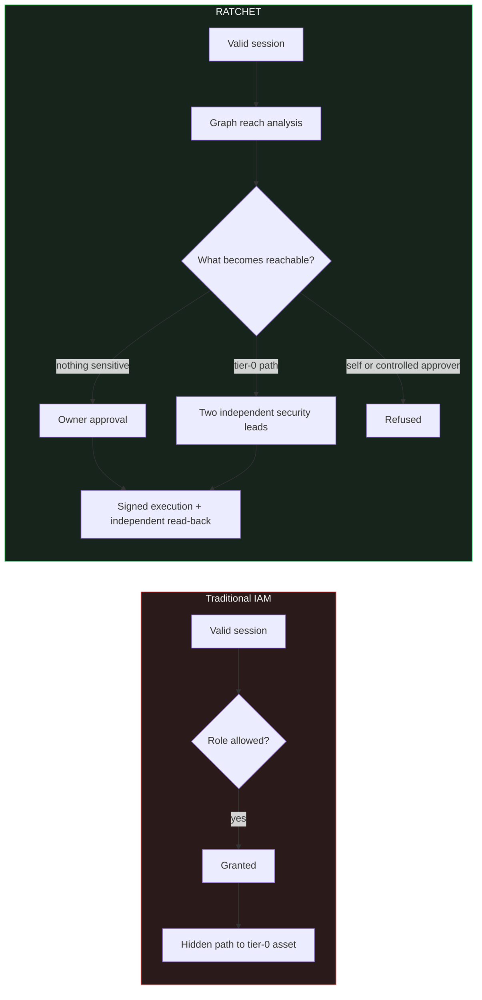

Two principles shape the design:

- **Consequence over identity.** Decisions come from the authorisation graph *after* the proposed change, not from the requester's title.
- **Asymmetric access.** Granting power is slow and governed, while taking power away should be fast and safe. RATCHET classifies a change as a *reduction* only when graph analysis proves it. A change is never treated as a reduction just because the requester says so.

---

## What the prototype demonstrates

RATCHET is a hackathon prototype built to production-grade engineering standards. To keep what you can see working separate from what's still in progress, every capability is labelled:

| Capability | Status | Where to see it |
|---|:---:|---|
| Consequence assessment: newly reachable resources, tier-0 paths, changed powers, weakened safeguards | ✅ **Live demo** | Console › Changes and Impact |
| Independent approval with passkeys (WebAuthn). The browser verifies the exact canonical envelope before signing. | ✅ **Live demo** | Console › Changes › *Review exact change* |
| Self-approval, duplicate approval and insufficient quorum refused (owner quorum 1, tier-0 quorum 2) | ✅ **Live demo** | Walkthrough steps 3–8 |
| Signed commands to the target plus independent read-back before `EXECUTED` | ✅ **Live demo** | Real HTTP probes change between 403 and 200 |
| Tamper-evident, hash-linked audit ledger | ✅ **Live demo** | Console › Audit |
| Reviewed revocation that restores the starting access | ✅ **Live demo** | Walkthrough final step |
| Restricted, server-redacted views for requesters and owners | ✅ **Live demo** | Requester cannot list the organisation graph |
| Minimum-disruption containment planning (weighted min-cut over the graph) | 🧪 **Implemented and tested** | `internal/graph/containment.go`, `e2e/scenarios/contain_rahul` |
| Kubernetes RBAC adapter and fail-closed admission webhook | 🧪 **Implemented and tested** | `internal/connector/k8s`, `cmd/ratchet-k8s-webhook` |
| Temporary-access expiry and drift-watch correction | 🧪 **Implemented and tested** | `internal/connector`, `internal/workflow` |
| Offline audit-chain and proof-bundle verification | 🧪 **Implemented and tested** | `ratchetctl audit verify` |
| Independent Authority: M-of-N governed policy and approver registry, separate database, governance UI | 🚧 **In progress** | `completion-a` profile, `internal/authority`, Console › Security policy |
| Containment execution: four priority actions, exact-plan authorisation, incident lifecycle | 🚧 **In progress** | `internal/workflow/containment.go`, Console › Incidents |
| Typed restoration flows with fresh independent review | 🚧 **In progress** | `internal/workflow/execution.go` |

> ✅ Exercised end to end in the browser prototype against a stateful exchange simulator. 🧪 Implemented with automated tests, but not yet part of the live demo. 🚧 Wired on `main`; end-to-end acceptance still open.

---

## Screenshots

> The landing site and restyled console below come from the demo-ready redesign in review in [#2](https://github.com/sakararya43-web/Ratchet/pull/2). The recorded walkthrough shows the console currently on `main`.

### Public site

| Landing page | The protocol |
|:---:|:---:|
|  | 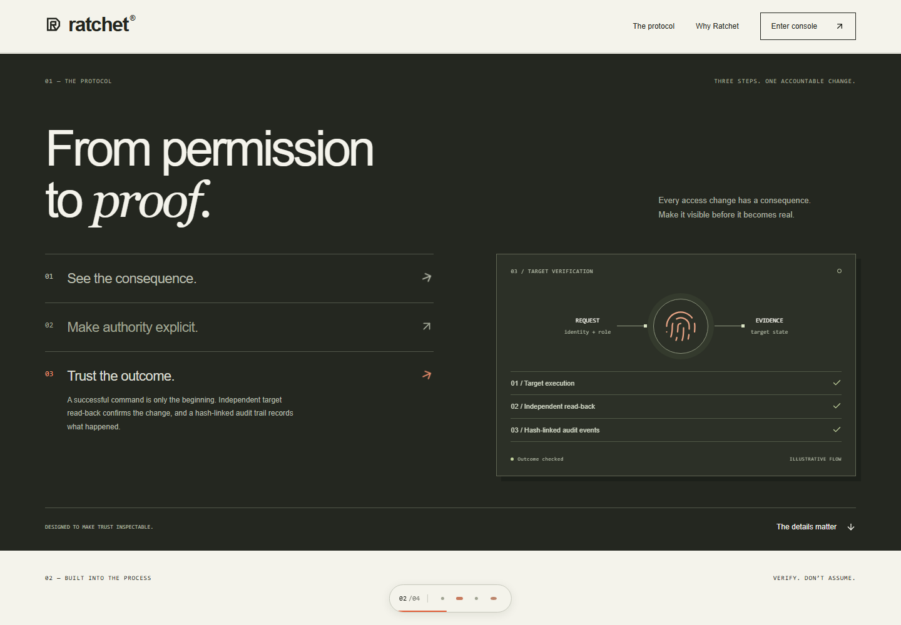 |

### Operator console

| Overview, organisation-wide view of a security lead | Infrastructure: observed authorisation graph |
|:---:|:---:|
|  | 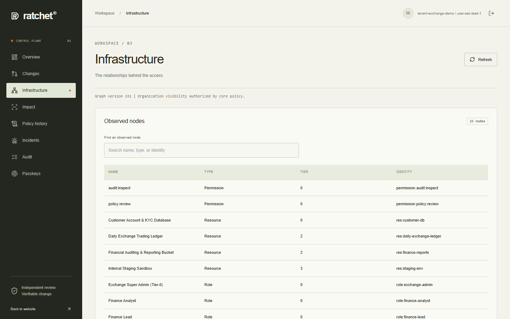 |
| **Audit: one wallet grant from request to verified execution** | **Sign-in** |
| 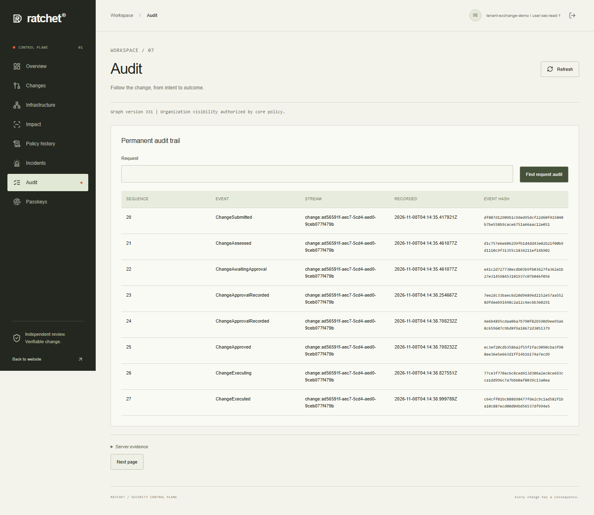 | 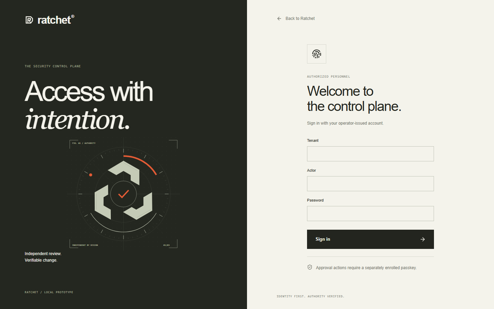 |

The audit view shows the two separate `ChangeApprovalRecorded` events required by the tier-0 quorum, followed by `ChangeExecuting` and `ChangeExecuted`. Each event carries its own hash in the chain.

### Recorded walkthrough

<details>
<summary><b>Four key moments from the recorded demo rehearsal (click to expand)</b></summary>
<br>

These frames come from the recorded presenter rehearsal on 2026-11-08 and show the dark console theme currently on `main`. The behaviour is the same in the redesign.

| 1 · A valid session cannot approve its own escalation | 2 · The owner reviews the exact consequence |
|:---:|:---:|
| 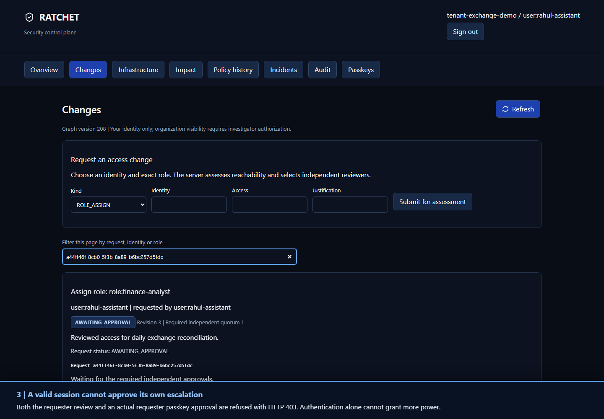 | 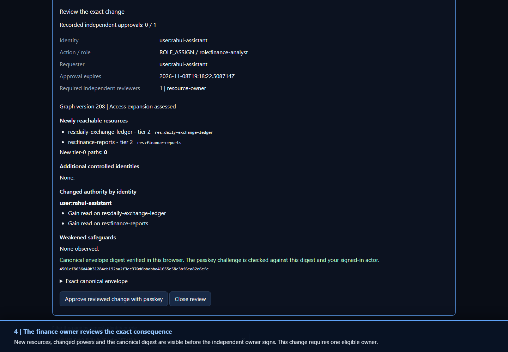 |
| **3 · Tier-0 access: one approval is not enough** | **4 · Quorum reached, execution independently verified** |
| 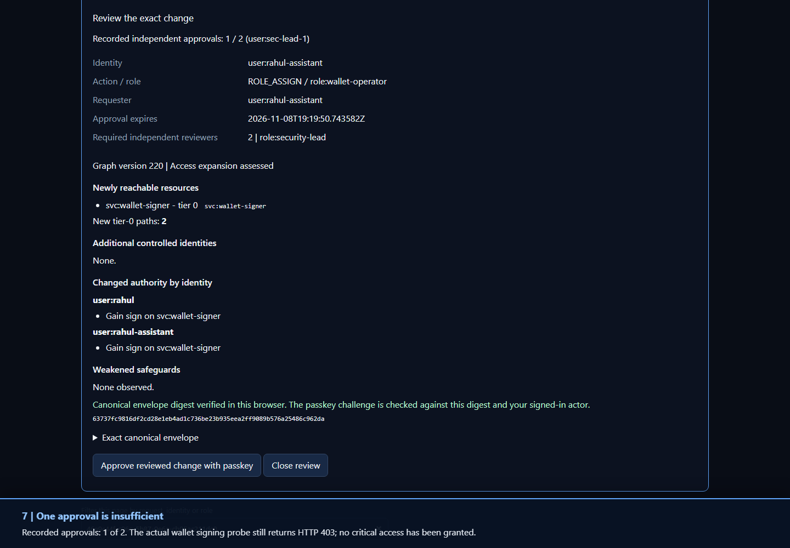 | 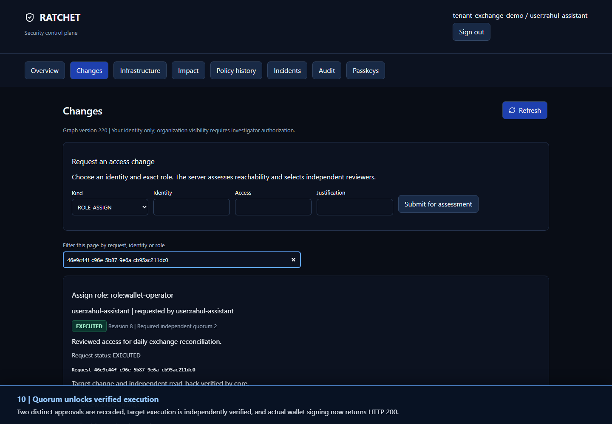 |

</details>

---

## How it works

Every access change follows the same path: **assess → approve → execute → verify → record**.

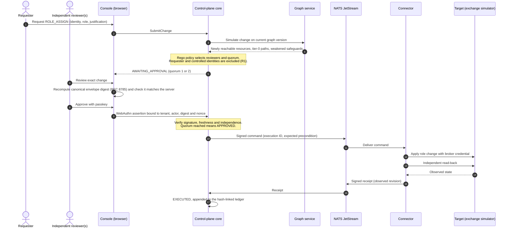

### Change lifecycle

The state machine lives in [`internal/domain/change.go`](internal/domain/change.go). It is pure and deterministic, and it never skips verification.

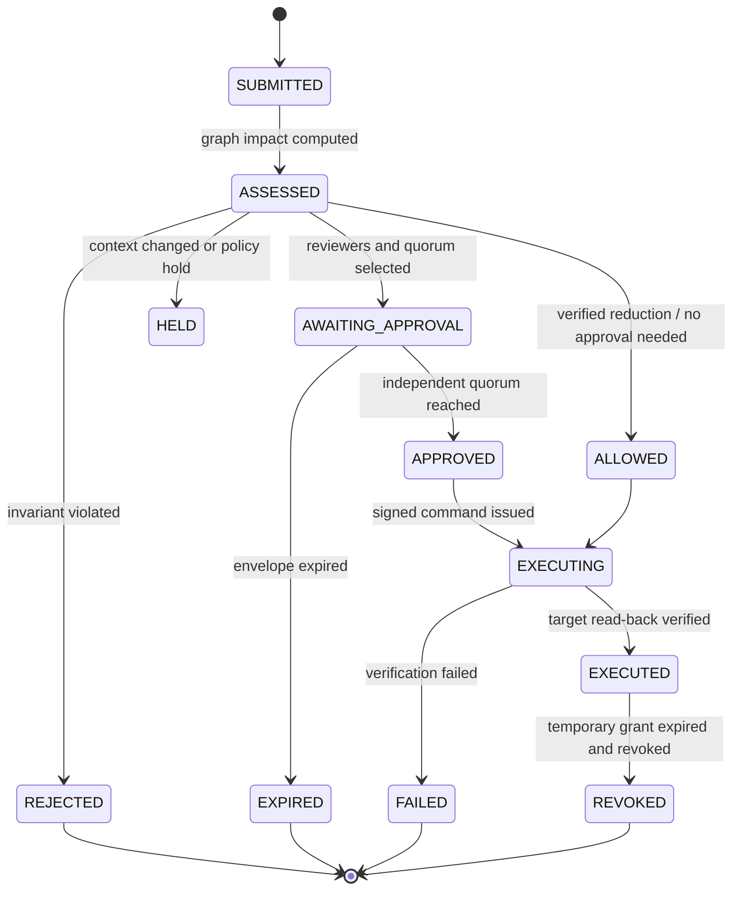

### What the reviewer actually signs

A passkey approval cannot be replayed against a different change, a different reviewer or a stale graph. The challenge binds all of them together:

```text
challenge = SHA-256( "RATCHET_APPROVAL_V1:" ‖ tenant ‖ actor ‖ change_digest ‖ nonce )
change_digest = SHA-256( RFC 8785 canonical JSON of the exact approval envelope )
```

The browser recomputes `change_digest` independently, in TypeScript and with the same golden test vectors as the Go backend, before it asks the authenticator to sign. If the server shows one change and signs another, the browser refuses.

### Tamper-evident audit ledger

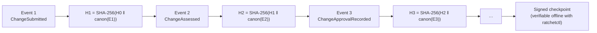

Changing, removing or reordering any event breaks every later hash. `ratchetctl audit verify --expected-tip=<hex>` also detects a ledger that has been cut short.

---

## Architecture

### Runtime: the local prototype

The prototype runs as hardened containers: read-only root filesystems, all Linux capabilities dropped, `no-new-privileges`, a non-root user and pinned image digests. Only two ports are published, and both bind to `127.0.0.1`.

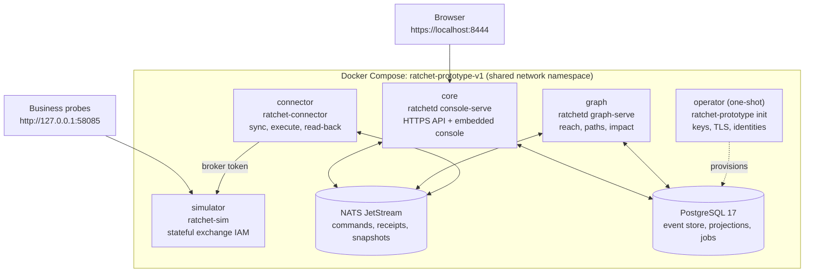

The **`completion-a`** profile ([`deploy/completion-a.compose.yaml`](deploy/completion-a.compose.yaml)) adds the standalone **Independent Authority** (`ratchet-authority`) with its own PostgreSQL, an enrollment-only server and M-of-N governed policy and registry rotation.

### Logical components

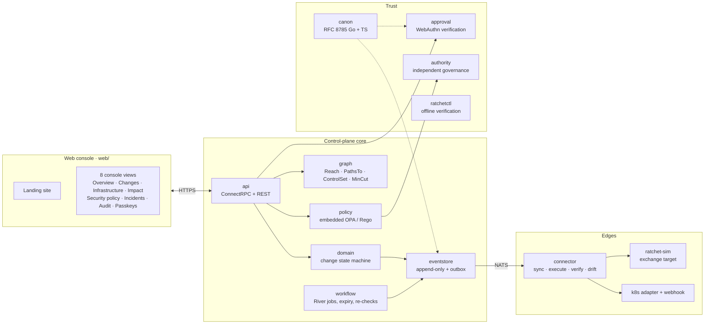

The two halves of the codebase meet only through typed contracts in [`proto/ratchet/v1/`](proto/ratchet/v1/) and [`internal/ports/`](internal/ports/).

---

## Security invariants

These rules are enforced in code and covered by tests. The **Status** column shows where each one can be observed today.

| ID | Invariant | What it means | Status |
|---|---|---|:---:|
| **R1** | No self-escalation | Nobody approves an expansion of their own reach, or the reach of anyone in their control set. | ✅ |
| **R2** | Reductions are computed, not claimed | A change counts as a reduction only if graph analysis proves no identity gains reach and no safeguard weakens. | ✅ |
| **R3** | Approve exactly what you saw | Approvals bind to the canonical digest of the exact envelope. If the context goes stale, the change is re-assessed. | ✅ |
| **R4** | Rules are independently governed | Policy, approver registry and thresholds change only by an M-of-N quorum of the *current* epoch. | 🧪 |
| **R5** | Nothing is erased | Every decision and observation is appended to a hash chain. | ✅ |
| **R6** | Fail closed for escalation, open for reduction | When degraded, targets refuse privilege increases while revocations stay executable. | 🧪 |
| **R7** | Explainable decisions | Decisions come from Rego policy and deterministic graph reach. There are no opaque risk scores. | ✅ |
| **R8** | Minimum-disruption containment | Containment cuts paths to tier-0 assets while preserving unrelated access. | 🧪 |
| **R9** | Proportional visibility | Requesters and owners get server-redacted views. Organisation-wide visibility requires policy authorisation. | ✅ |

---

## Quick start

### Prerequisites

| Tool | Version | Used for |
|---|---|---|
| Docker (with Compose v2) | recent | Builds and runs everything. Go is **not** needed on the host. |
| Python | 3.11+ | Launcher scripts |
| Node.js | 20+ | Console development and browser tests (optional) |
| Browser with a platform authenticator | — | Passkey approvals (Windows Hello, Touch ID or a security key) |

### Run the prototype

```bash
git clone https://github.com/sakararya43-web/Ratchet.git
cd Ratchet

# Build images, provision keys/TLS/identities, start every service
python scripts/prototype.py start
```

On first start, the launcher generates random database and broker secrets, creates a local certificate authority, provisions four demo identities and waits for every service to report healthy. Private material is written to `.local/prototype/`, which is gitignored:

| File | Contents |
|---|---|
| `.local/prototype/users.json` | Sign-in passwords and one-use passkey enrollment tickets for the four demo accounts |
| `.local/prototype/ca.pem` | Public certificate of the local HTTPS authority |

1. **Trust the local HTTPS certificate.** Import `.local/prototype/ca.pem` into your OS or browser trust store. Certificate checks stay on, because passkeys need a secure origin.
2. Open **https://localhost:8444** and sign in with an account from `users.json`.
3. Under **Passkeys**, register a passkey for each reviewer with its one-use enrollment ticket. Run `python scripts/prototype.py invite --actor <actor>` to issue a fresh ticket.

The [prototype runbook](docs/ishaan/prototype-runbook.md) covers credential management, restarts and recovery in detail.

### Useful commands

```bash
python scripts/prototype.py status                          # container status
python scripts/prototype.py restart --no-build              # restart services, keep identities, ledger and target state
python scripts/prototype.py stop                            # stop containers, keep volumes
python scripts/prototype.py credentials                     # re-export users.json and ca.pem
python scripts/prototype.py invite --actor user:sec-lead-1  # one-use passkey enrollment ticket
python scripts/prototype.py renew-tls                       # rotate the local TLS certificate
```

Real target probes (403 before a grant, 200 after verified execution):

```bash
curl -s -o /dev/null -w "%{http_code}\n" -X POST http://127.0.0.1:58085/api/v1/business/finance-report/read \
  -H "Content-Type: application/json" -d '{"session_id":"session:intern-workstation-1"}'
curl -s -o /dev/null -w "%{http_code}\n" -X POST http://127.0.0.1:58085/api/v1/business/wallet/sign \
  -H "Content-Type: application/json" -d '{"session_id":"session:intern-workstation-1","amount_usd":100}'
```

### Develop the console

```bash
cd web
npm ci
npm run dev        # Vite dev server
npm test           # canonical JSON and approval-envelope tests
npm run build      # type-check + production bundle
```

---

## Demo walkthrough

The demo uses four independent accounts in the tenant `tenant-exchange-demo`:

| Account | Role in the story |
|---|---|
| `user:rahul-assistant` | Requester: starts with **no** finance or wallet access |
| `user:finance-lead` | Resource owner for finance resources |
| `user:sec-lead-1`, `user:sec-lead-2` | Independent security leads, both required for tier-0 access |

```mermaid
flowchart LR
    A["Start<br/>finance 403 · wallet 403"] --> B["Request finance-analyst"]
    B --> C["Self-approval refused"]
    C --> D["Finance owner approves<br/>finance 200"]
    D --> E["Request wallet-operator<br/>2 new tier-0 paths"]
    E --> F["Lead 1 approves<br/>1 of 2, wallet still 403"]
    F --> G["Lead 1 again: duplicate refused"]
    G --> H["Lead 2 approves<br/>wallet 200"]
    H --> I["Audit trail shows both approvals"]
    I --> J["Reviewed revocations<br/>finance 403 · wallet 403"]
```

1. **Requester** submits `ROLE_ASSIGN` → `role:finance-analyst`. The request reaches `AWAITING_APPROVAL`. The requester's own approval attempt returns **403**.
2. **Finance owner** opens *Review exact change*, checks the two newly reachable tier-2 resources and the verified digest, then approves with a passkey. After independent read-back, the finance probe returns **200**.
3. **Requester** submits `ROLE_ASSIGN` → `role:wallet-operator`. The assessment shows **2 new tier-0 paths**, which requires two security leads.
4. **Security lead 1** approves. The record shows 1 of 2 approvals and wallet signing still returns **403**. A second approval from the same lead is refused.
5. **Security lead 2** approves. The change executes, read-back is verified and wallet signing returns **200**.
6. **Audit** shows both approval events and the execution, each with its own hash in the chain.
7. Reviewed **ROLE_REVOKE** requests return both probes to **403**. Nothing is reset: the ledger, identities and trust root stay intact.

The step-by-step guide is in [`docs/ishaan/prototype-walkthrough.md`](docs/ishaan/prototype-walkthrough.md). PR [#2](https://github.com/sakararya43-web/Ratchet/pull/2) adds a timed presenter script and a four-window presenter launcher. The launcher uses virtual CTAP2 authenticators with real backend signature verification.

---

## Testing and quality

```bash
# Go: build, vet, unit + scenario tests (runs fine inside the golang:1.27.3 image)
go build ./... && go vet ./... && go test -count=1 ./...

# Console: types, unit tests, production build
cd web && npx tsc --noEmit && npm test && npm run build

# Full browser acceptance against the running prototype (real passkey ceremonies)
python scripts/prototype-browser.py
```

| Suite | What it covers |
|---|---|
| **Unit and property tests** | State machine, graph reach and min-cut, Rego decisions, canonical JSON, WebAuthn verification, event store and outbox |
| **Attack scenarios** ([`e2e/scenarios/`](e2e/scenarios/)) | Self-approval, controlled-approver refusal, safeguard edit versus governed amendment, containment of a compromised identity |
| **Cross-language golden vectors** ([`testdata/canon/`](testdata/canon/)) | Go and TypeScript produce byte-identical canonical JSON and digests |
| **Integration** (build tags `integration`, `peerintegration`) | PostgreSQL event store, Authority database, crash and restart recovery, the full attack families |
| **Browser acceptance** ([`web/e2e/`](web/e2e/)) | Four-account approval journey and Authority flows over real HTTPS |
| **Hosted CI** | [CI](.github/workflows/ci.yml) and [Core phase checks](.github/workflows/core.yml) on every push to `main`, including the built-image browser journey on Linux |

The badges at the top show live CI status. They are the authoritative signal for the current commit.

---

## Repository layout

```text
Ratchet/
├── cmd/
│   ├── ratchetd/              # Control-plane core: console API, graph service, enrollment, recovery
│   ├── ratchet-prototype/     # Operator tool: init, TLS, identities, invites, health
│   ├── ratchet-authority/     # Standalone Independent Authority service
│   ├── ratchet-connector/     # Outbound connector runtime
│   ├── ratchet-sim/           # Stateful simulated crypto exchange (target)
│   ├── ratchet-k8s-webhook/   # Kubernetes validating admission webhook
│   └── ratchetctl/            # CLI: genesis, policy/registry governance, offline audit verify
├── internal/
│   ├── domain/                # Pure change state machine and invariants
│   ├── graph/                 # Reach, PathsTo, ControlSet, impact, min-cut containment
│   ├── policy/                # Embedded OPA engine and bundle verification
│   ├── workflow/              # River jobs: execution, expiry, containment, incidents
│   ├── eventstore/  bus/      # Append-only store, outbox, NATS relay
│   ├── api/                   # ConnectRPC and REST handlers, sessions, privacy redaction
│   ├── approval/              # WebAuthn registration and assertion verification
│   ├── authority/  trust/     # Independent governance, genesis, checkpoints
│   ├── canon/  audit/  ledger/# RFC 8785 canonical JSON, hash chain, verification
│   ├── connector/             # Sync, execute, read-back, drift (+ k8s/, sim/ adapters)
│   └── webassets/             # Production console embedded into the Go binary
├── web/                       # React 19 + Vite console and landing site
├── policies/                  # Rego authorisation and change policies (+ tests)
├── proto/ratchet/v1/          # ConnectRPC / protobuf contracts
├── e2e/scenarios/             # Attack-scenario acceptance tests
├── deploy/                    # Dockerfiles and Compose profiles (prototype, completion-a, core)
├── scripts/                   # Launchers, acceptance runners, demo presenter
├── testdata/                  # Golden vectors, seed organisation, fixtures
└── docs/                      # Runbooks, evidence, design notes, screenshots
```

---

## Tech stack

| Area | Technology |
|---|---|
| Backend | **Go 1.27**, ConnectRPC 1.19, pgx 5, River 0.51 (jobs), goose (migrations) |
| Policy | **Open Policy Agent** 1.22 (embedded Rego) |
| Messaging | **NATS JetStream** 2.11 |
| Storage | **PostgreSQL 17** with separate migrator, runtime and projector roles |
| Identity | **WebAuthn** passkeys (go-webauthn 0.18), domain-separated challenges |
| Canonicalisation | **RFC 8785** JSON Canonicalization Scheme in Go and TypeScript |
| Frontend | **React 19**, TypeScript 5.7, Vite 6, Tailwind CSS 3.4, Lucide icons |
| Testing | Go testing + `rapid` property tests, Node test runner, Playwright |
| Packaging | Multi-stage Docker builds, digest-pinned bases, read-only non-root containers |

All dependencies are free and open source. The project uses no paid services.

---

## Known limits

We'd rather state these limits up front than have reviewers find them:

- **Single-host demonstration.** All services share one machine. Running them as separate processes with separate keys is not isolation from that machine's administrator. In production, the Independent Authority belongs on separately administered infrastructure.
- **Virtual authenticators in automation.** Automated browser runs use Chromium's virtual CTAP2 authenticators. Signature verification is real, but this does not certify physical hardware keys. Manual use works with platform authenticators such as Windows Hello or Touch ID.
- **Simulated target.** `ratchet-sim` models a crypto exchange's IAM. It is a security demonstration target, not a real financial system.
- **Localhost only, for now.** The prototype's passkey relying-party ID and TLS certificate are issued for `localhost`. A public deployment needs the [roadmap](#roadmap) work below.
- **Containment and restoration are not yet accepted end to end.** The engine, the priority actions and the console wiring are on `main`. Exact-plan retries, residual-reach verification and the full action and restoration acceptance suite are still open.
- **Break-glass during a full control-plane outage** (PRD FR-X6) is specified but deferred. Revocations take priority over grants, but a multi-party emergency path for total loss of the control plane is future work.
- **Ledger truncation.** Offline verification proves events weren't modified or reordered. To detect a ledger that has been cut short, supply an expected tip or a signed checkpoint.

---

## Roadmap

```mermaid
flowchart LR
    subgraph Now["Next: finish and share"]
        N0["Merge the demo-ready redesign (#2)"]
        N1["Configurable origin and passkey RP ID"]
        N2["Hosted demo<br/>free VM + Cloudflare Tunnel + Access"]
        N3["One-click demo reset<br/>without touching the ledger"]
    end
    subgraph Next["Then: complete the story"]
        X1["Containment acceptance<br/>exact-plan retries, residual-reach proof"]
        X2["Restoration acceptance<br/>typed flows with fresh review"]
        X3["Interactive graph explorer<br/>visual paths to tier-0"]
        X4["Live Authority ceremony<br/>member rotation in the browser"]
    end
    subgraph Later["Later: towards production"]
        L1["Real connectors<br/>AWS IAM · Entra ID · Okta · GitHub"]
        L2["Kubernetes enforcement<br/>parity with the simulator journey"]
        L3["Break-glass quorum (FR-X6)"]
        L4["Physically separated Authority<br/>HSM / hardware-key signers"]
        L5["Witnessed checkpoints<br/>external transparency log"]
    end
    Now --> Next --> Later
```

| Horizon | Item | Why it matters |
|---|---|---|
| **Next** | Merge the redesign and presenter tooling ([#2](https://github.com/sakararya43-web/Ratchet/pull/2)) | One `main` with the new landing site, console and demo launcher |
| | Configurable origin and RP ID, hosted demo behind Cloudflare Access | Lets judges and reviewers try the real thing without a local setup |
| | Demo reset that preserves the ledger | Repeatable demos without weakening the "nothing is erased" rule |
| **Then** | Containment and restoration acceptance | Turns the wired min-cut execution and restoration flows into an end-to-end, verified demo |
| | Live Authority ceremony in the browser | Member addition, removal and credential rotation under the current quorum |
| | Visual graph explorer | Shows *why* a role reaches a tier-0 asset, not just that it does |
| **Later** | Cloud and identity-provider connectors | The connector contract already separates targets. Each new target needs sync, execute and read-back. |
| | Break-glass, separated Authority, external witnesses | Closes the remaining gaps in the trust model for production use |
| | Multi-tenant operations, metrics and SIEM export | Operational readiness for real security teams |

---

## Team

Built for the **[DataNova 2026 Global Data-Thon](https://datanova-2026-global-data-thon.devpost.com/)**.

| | Focus |
|---|---|
| **Ishaan Sharma** · [@ishaans04](https://github.com/ishaans04) | Control-plane core: domain model, event store, graph analysis, policy, workflow, console API |
| **Sakar Arya** · [@sakararya43-web](https://github.com/sakararya43-web) | Trust and edges: canonical JSON, passkeys, Independent Authority, connectors, simulator, Kubernetes |

---

## Further documentation

| Document | Purpose |
|---|---|
| [Prototype walkthrough](docs/ishaan/prototype-walkthrough.md) | Four-account demo, step by step |
| [Prototype runbook](docs/ishaan/prototype-runbook.md) | Build, start, trust TLS, manage credentials |
| [Prototype acceptance](docs/ishaan/prototype-acceptance.md) | Recorded acceptance results and retained scope |
| [PR #2: demo-ready redesign](https://github.com/sakararya43-web/Ratchet/pull/2) | Landing site, console redesign, presenter script and UI design notes |
| [Security hardening](docs/security_hardening.md) · [Trust limits](docs/trust_limits.md) | Threat model boundaries and container hardening |
| [Architecture](RATCHET_Architecture.md) · [PRD](PRD.md) · [Idea document](RATCHET_Full_Idea_Document.md) | Full specification |
| [Changelog](CHANGELOG.md) | Engineering history |
