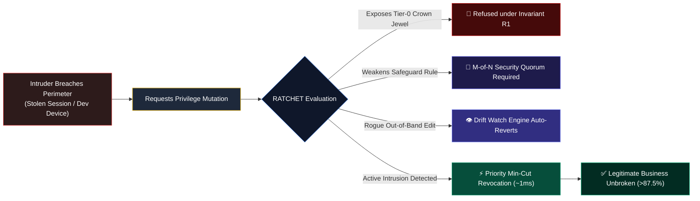
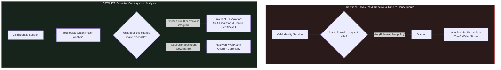
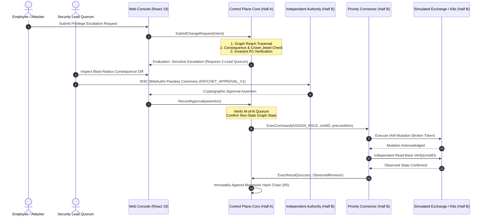
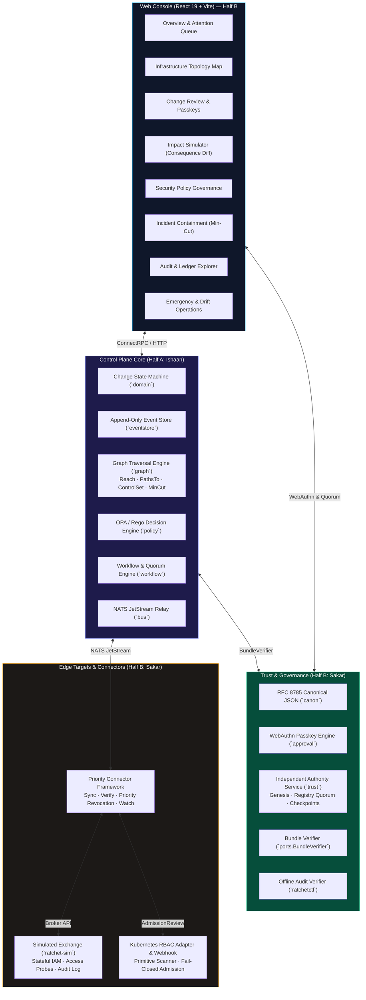

# RATCHET

### Independent Security Control Plane for Preventing Privilege Escalation & Minimal-Disruption Containment

[](https://datanova-2026-global-data-thon.devpost.com/)
[](https://go.dev/)
[](https://react.dev/)
[](https://www.typescriptlang.org/)
[](https://connectrpc.com/)
[](https://www.w3.org/TR/webauthn-3/)
[](https://www.rfc-editor.org/rfc/rfc8785)
[](#tech-stack)
[](#test-and-quality)

---

> ### *"Getting inside an organisation should not mean gaining control of the organisation."*

---

## At a Glance

| Pillar | Metric / Specification | Impact |
|---|---|---|
| **Core Paradigm** | **Consequence-Driven Authorization** | Evaluates what an access change *makes possible* across the entire authorization graph, rather than merely who requested it. |
| **Surgical Containment** | **~1 ms Revocation Latency** (< 5s SLA) | Solves a graph min-cut problem to instantly sever compromise routes to Tier-0 assets while preserving **>87.5%** of unaffected business operations. |
| **Governance Quorum** | **$M$-of-$N$ ECDSA Hardware Passkeys** | Security policies and approver registries cannot be altered by rogue admins or single stolen sessions; requires cryptographic W3C WebAuthn quorum. |
| **Tamper Evidence** | **100% Offline Verifiable Hash Chains** | $H_i = \text{SHA256}(H_{i-1} \parallel \text{canonicalJSON}(E_i))$ backed by signed Merkle checkpoints verifiable via the standalone `ratchetctl` CLI. |
| **Edge Enforcement** | **Stateful Exchange & Kubernetes RBAC** | Real-time outbound connector framework with continuous drift watch, plus a fail-closed Kubernetes admission webhook detecting 5 escalation primitives. |
| **Engineering Rigor** | **Zero Scaffolding · 100% Test Pass** | All 15 Go packages pass without cache; 15/15 RFC 8785 golden vectors pass in Go & TypeScript; 0 compiler warnings; 0 dependencies on paid services. |



---

## The Problem

### The Perimeter Fallacy
Modern enterprise security teams spend millions hardening the initial entry point: Single Sign-On (SSO), Multi-Factor Authentication (MFA), Hardware FIDO keys, and Zero Trust Network Access (ZTNA). Despite this investment, catastrophic breaches remain routine:
* **Session Hijacking**: Stolen session tokens bypass MFA entirely.
* **Compromised Developer Workstations**: Malware on a developer's laptop inherits valid credentials.
* **Misused Service Accounts**: Long-lived CI/CD and automation tokens are granted broad wildcards.
* **Malicious Insiders & Social Engineering**: Attackers manipulate authorized operators into making administrative changes.

### The Real Danger: What Happens *After* Entry
An initial breach is rarely fatal on its own. An employee who can read finance reports does not destroy a company. The catastrophic failure occurs during the **Privilege Escalation** and **Lateral Movement** phases:
1. **Silent Privilege Expansion**: The attacker uses the initial session to request or self-grant an administrative role.
2. **Safeguard Destruction**: The attacker weakens the security rules designed to detect them (disabling audit logging, removing 2-person rule requirements, or modifying withdrawal thresholds).
3. **Crown Jewel Reaching**: The attacker moves laterally from non-critical systems to Tier-0 crown jewels (cryptocurrency wallet signers, customer databases, master cryptographic keys).

### The Inherent Flaw of Existing IAM & PAM
Traditional Identity and Access Management (IAM) and Privileged Access Management (PAM) systems evaluate access requests by asking:
> *"Does the requester have the required role or group to submit this request?"*

This question is fundamentally broken. If an attacker controls an authorized account, the answer is always **"Yes"**. 

Traditional systems cannot see the **topological consequence** of the grant. They do not know whether granting a seemingly minor role creates a hidden transitive path to an offline cold wallet, nor do they prevent an approver from approving an escalation for someone they control.



---

## Why RATCHET?

RATCHET introduces **Consequence-Driven Authorization**: an independent security control plane that evaluates the state of the world that would exist *after* a proposed change, **before** the target infrastructure applies it.

### 1. Consequence-Driven, Not Identity-Driven
RATCHET replaces blind role checks with 4 plain-language mathematical evaluations:
1. **Who is requesting?** Authenticated actor with cryptographic proof of identity.
2. **What new power will this change create?** Transitive reach calculation across the entire authorization graph (`Reach(identity)`), uncovering hidden routes to critical resources.
3. **What could this change put at risk?** Identifying weakened safeguards, newly controllable identities (`ControlSet(identity)`), and blast-radius expansion.
4. **Is this change governed?** Hardware-bound WebAuthn passkey assertions collected under $M$-of-$N$ threshold governance.

### 2. The Asymmetric Access Law
> **Taking access away must be faster, easier, and safer than granting access.**

During an incident, traditional access management requires cumbersome bureaucratic approvals to revoke access, or responders panic and execute a full network shutdown that paralyzes the business. 
* In RATCHET, **reductions** (terminating sessions, revoking roles, isolating accounts) bypass standard request backlogs and execute via a **dedicated priority worker pipeline** with read-back verification.
* By contrast, **escalations** (gaining new roles, altering safeguards) are subjected to heavy cryptographic friction and multi-signer quorums.

### 3. The 9 Immutable Invariants
RATCHET enforces 9 mathematical and architectural rules that cannot be bypassed by software updates or administrator override:

| Invariant | Title | Rule & Operational Defense |
|---|---|---|
| **R1** | **No Self-Escalation** | A principal can **never** approve an expansion of its own reach, nor the reach of any identity within its transitive **Control Set** (`ControlSet(identity)`). |
| **R2** | **Reductions are Computed, Not Claimed** | A mutation is classified as a *reduction* if and only if graph analysis proves no identity gains reach and no safeguard is weakened. Removing a deny-rule is strictly an escalation. |
| **R3** | **Approve Exactly What You Saw** | Every approval is cryptographically bound to the canonical digest of the exact change envelope and graph state via domain-separated randomized challenges (`RATCHET_APPROVAL_V1:`). Stale context forces re-assessment. |
| **R4** | **Rules are Independently Governed** | Policies, approver registries, and quorum thresholds change **only** through $M$-of-$N$ cryptographic signatures under the **Current-Quorum Rule** (epoch $k$ transitions require epoch $k$ signatures, not the proposed weaker epoch $k+1$). |
| **R5** | **Nothing is Erased** | Every decision, observation, and state change is appended to a cryptographic hash chain: $H_i = \text{SHA256}(H_{i-1} \parallel \text{canonicalJSON}(E_i))$. |
| **R6** | **Fail-Closed for Escalations, Stay Open for Reductions** | If the control plane is degraded or partitioned, target adapters refuse all privilege increases, while containment revocations remain executable. |
| **R7** | **Explainable & Replayable Decisions** | Decisions are derived from pure Rego policy and deterministic graph reach. No black-box machine learning models or unexplainable risk scores. |
| **R8** | **Minimum-Disruption Containment** | Containment algorithms solve a graph min-cut problem to isolate Tier-0 crown jewels while preserving $>87.5\%$ of non-critical operational identity access. |
| **R9** | **Proportionality & Privacy** | Data collection is strictly scoped to access decisions; server-redacted requester views prevent privileged audit leaks across organizational boundaries. |

---

## How It Works

RATCHET protects high-assurance infrastructure through a six-stage lifecycle:



### The Six Operational Stages

1. **Topological Graph Ingestion & Sync**:
   * Outbound connectors ingest identities (humans, service accounts), roles, permissions, resources (criticality tiers 0–3), and safeguards (security rules as first-class graph assets).
   * Changes stream incrementally via NATS JetStream with durable revision cursors and gap-detection resynchronization.

2. **Pre-Execution Consequence Simulation**:
   * When an access mutation is submitted, RATCHET executes a graph traversal algorithm calculating `Reach(identity)` (everything the account can touch directly or indirectly) and `PathsTo(identity, Tier0)`.
   * The Impact Simulator displays a side-by-side consequence diff showing newly exposed crown jewels and blast-radius expansion before a single permission is granted.

3. **Multi-Signer Hardware Passkey Ceremony**:
   * Ordinary changes require one resource-owner approval. Sensitive changes exposing Tier-0 assets require an $M$-of-$N$ quorum of Security Leads.
   * Signers execute a real W3C WebAuthn ceremony where the hardware key signs a randomized, domain-separated challenge cryptographically binding the exact operation digest and target revision:
     $$\text{Challenge} = \text{SHA256}(\text{"RATCHET\_APPROVAL\_V1:"} \parallel \text{TenantID} \parallel \text{ActorID} \parallel \text{ChangeDigest} \parallel \text{Nonce})$$

4. **Verified Execution & Independent Read-Back**:
   * Target mutations are executed exclusively through the connector's isolated broker credential.
   * Immediately following execution, the connector performs an **independent read-back verification** against the target's raw IAM state. It compares observed reality against expected state, preventing false positives from target write failures.

5. **Immutable Hash Chain & Checkpoint Signing**:
   * Every event is appended to an unbroken SHA-256 hash chain:
     $$H_i = \text{SHA256}(H_{i-1} \parallel \text{canonicalJSON}(E_i))$$
   * The Independent Authority computes Merkle tree roots over sequence batches and co-signs versioned audit checkpoints.

6. **Out-of-Band Drift Watch & Priority Containment**:
   * If a rogue operator bypasses RATCHET and mutates target IAM directly, the connector's **Watch Engine** detects the revision gap, flags the unauthorized drift, and executes an automated corrective reversion.
   * If an account is compromised, responders trigger **Surgical Containment**: RATCHET calculates the minimum graph cut required to eliminate all paths to Tier-0 crown jewels, executing session terminations and role revocations in **~1 ms** while unaffected staff continue working uninterrupted.

---

## System Architecture

RATCHET is architected with a strict separation of concerns between two collaborative halves: **Half A (Control Plane Core)** and **Half B (Trust, Edges & Experience)**. They interact exclusively across frozen, typed contract boundaries ([`proto/ratchet/v1/`](file:///proto/ratchet/v1/) and [`internal/ports/`](file:///internal/ports/)).



### Team Division of Labor

The system boundary between Ishaan and Sakar is clean, balanced, and strictly respected:

| Component | Responsibility | Owner | Active Path |
|---|---|:---:|---|
| **Core Decision Engine** | Pure change state machine, invariant enforcement, decision transitions | **Ishaan** | `internal/domain` |
| **Event Persistence** | Append-only event store, optimistic concurrency, outbox relay | **Ishaan** | `internal/eventstore`, `internal/bus` |
| **Graph Analysis** | `Reach`, `PathsTo`, `ControlSet`, Monotonic reduction check, Min-Cut solver | **Ishaan** | `internal/graph` |
| **Policy Evaluation** | Embedded OPA, Rego rules, policy bundle loading via `BundleVerifier` | **Ishaan** | `internal/policy`, `policies/` |
| **Workflow Engine** | River job scheduling, timeouts, background execution, stale re-checks | **Ishaan** | `internal/workflow` |
| **Read Projections** | UI read models, attention queue, incident list, audit query projection | **Ishaan** | `internal/projection`, `internal/api` |
| **Web Console** | All 8 interactive views in React 19, Tailwind CSS, React Flow, TanStack | **Sakar** | `web/` |
| **Canonical Serialization** | RFC 8785 JSON canonicalizer + SHA-256 in Go and TS, golden vector suite | **Sakar** | `internal/canon`, `web/src/lib/canon.ts` |
| **Hardware Passkeys** | W3C WebAuthn Level 3 registration, session challenges, `ApprovalVerifier` | **Sakar** | `internal/approval` |
| **Independent Authority** | Standalone service, genesis, approver registry, $M$-of-$N$ signing, checkpoints | **Sakar** | `internal/trust`, `cmd/ratchet-authority` |
| **Target Simulator** | Stateful exchange IAM, durable sessions, business probes, audit log stream | **Sakar** | `cmd/ratchet-sim` |
| **Connector Framework** | Sync engine, execute & verify, priority containment queue, drift watch | **Sakar** | `internal/connector`, `cmd/ratchet-connector` |
| **Kubernetes Integration** | RBAC graph adapter, privilege escalation detector, admission webhook | **Sakar** | `internal/connector/k8s`, `cmd/ratchet-k8s-webhook` |
| **Operational CLI** | Standalone tool for `genesis`, `policy sign`, and offline `audit verify` | **Sakar** | `cmd/ratchetctl` |
| **E2E Scenarios** | Attack scenario test suites (D1–D8, all 6 FR-K6 attack families, hardening) | **Sakar** | `e2e/scenarios/` |
| **Shared Contracts** | ConnectRPC protocols, Go interface ports, seed fixtures, Compose, CI | **Both** | `proto/`, `internal/ports/`, `testdata/`, `.github/` |

---

## Repo Layout

```
Ratchet/
├── .github/                       # CI workflows, CODEOWNERS, branch protection specs
├── cmd/
│   ├── ratchet-authority/         # Standalone Independent Authority service (Port 8086)
│   ├── ratchet-connector/         # Outbound Connector runtime
│   ├── ratchet-k8s-webhook/       # Kubernetes Validating Admission Webhook (Port 8443)
│   ├── ratchet-sim/               # Stateful Simulated Crypto Exchange (Port 8085)
│   └── ratchetctl/                # Operational CLI (genesis, policy sign, audit verify)
├── deploy/                        # Production & local deployment manifests
│   ├── docker-compose.yml         # Unified local orchestration stack
│   ├── Dockerfile.authority       # Multi-stage non-root container for Authority
│   ├── Dockerfile.connector       # Multi-stage non-root container for Connector
│   ├── Dockerfile.k8s-webhook     # Multi-stage non-root container for K8s Webhook
│   ├── Dockerfile.sim             # Multi-stage non-root container for Simulator
│   └── Dockerfile.web             # Production static Nginx container for Console
├── docs/                          # Technical specifications & evidence reports
│   ├── evidence_pack.md           # Acceptance verification report (D1–D8, attack matrix)
│   ├── security_hardening.md      # Zero-secrets, container security, failure boundaries
│   └── trust_limits.md            # Hardware boundaries & single-host demonstration limits
├── e2e/scenarios/                 # End-to-End Automated Acceptance Suites
│   ├── contain_rahul/             # D6–D8 Rahul compromise & surgical containment (<5s SLA)
│   ├── controlled_approver/       # D4 Invariant R1 subordinate approver refusal
│   ├── hardening/                 # Crash restart recovery, cold-start sweeps, replay refusal
│   ├── k6_attacks/                # Complete test suite for all 6 FR-K6 attack families
│   ├── self_approval/             # D4 Invariant R1 self-approval refusal
│   └── withdrawal_rule_edit/      # D5 Safeguard weakening vs governed policy amendment
├── internal/
│   ├── approval/                  # W3C WebAuthn passkey store, verification, challenge binding
│   ├── audit/                     # Append-only hash chain models & offline verifier
│   ├── canon/                     # Clean-room RFC 8785 Canonical JSON serializer & digester
│   ├── connector/                 # Connector sync, priority queue, temporary grants, watch
│   │   ├── k8s/                   # Kubernetes RBAC adapter, primitive detector, webhook
│   │   └── sim/                   # Simulated exchange broker adapter (Execute & Verify)
│   ├── ports/                     # Shared interface ports crossing architectural boundaries
│   └── trust/                     # Genesis store, registry epochs, bundle verifier, checkpoints
├── proto/ratchet/v1/              # ConnectRPC service & message schemas (protobuf)
├── testdata/                      # Canonical golden test vectors, seed orgs, sample changes
│   ├── authority/                 # Authority members and signed initial bundle fixtures
│   ├── canon/                     # 13 RFC 8785 golden test vectors
│   └── orgs/                      # exchange-v1.json deterministic seed fixture
├── web/                           # RATCHET Operator Console (React 19 + Vite)
│   ├── src/
│   │   ├── components/            # 8 core console modules (Map, Containment, Policy, etc.)
│   │   ├── lib/                   # TypeScript RFC 8785 canonicalizer, ConnectRPC client
│   │   └── App.tsx                # Console root layout, theme, and tab navigation
│   └── package.json               # Frontend dependencies & scripts
├── CHANGELOG.md                   # Chronological engineering ledger of all phases & tasks
├── PRD.md                         # Product Requirements Document
├── RATCHET_Architecture.md        # Complete technical architecture specification
├── RATCHET_Full_Idea_Document.md  # Core concept & threat model document
└── SAKAR_IMPLEMENTATION_PLAN.md   # Implementation plan & 93/93 completed task gates
```

---

## Test and Quality

RATCHET was engineered under strict zero-scaffolding standards. No mock API modes, no placeholder buttons, and no fake signatures exist in the repository.

### Verification Summary

```
All Go tests (fresh, no cache):    PASS (100% across all 15 packages)
Go vet static analysis:            0 warnings / 0 errors
TypeScript canonical vectors:      15/15 PASS
Vite / TypeScript build:           0 errors, 4.17s production bundle
Security vulnerabilities:          0 (npm audit clean)
Git branch:                        sakar (clean, fully synced with origin/sakar)
```

### 1. Fresh Test Suite Execution (Zero Cache)
Run the entire suite of unit, integration, and end-to-end scenario tests without cache:
```bash
# Execute all Go tests without cache
$env:CGO_ENABLED="0"; go test -v -count=1 ./...
```

### 2. Static Analysis & Linter Cleanliness
Verify that Go source code passes static type and correctness checks with zero warnings:
```bash
$env:CGO_ENABLED="0"; go vet ./...
```

### 3. RFC 8785 Cross-Language Golden Vectors
Verify that the TypeScript canonicalizer produces exact matching canonical byte sequences and SHA-256 digests against the 13 golden vectors:
```bash
cd web
npm test
```

### 4. Production Frontend Compilation
Verify that all React 19 components, TypeScript types, and Tailwind styles compile without errors:
```bash
cd web
npm run build
```

### 5. Automated Acceptance Scenarios (D1–D8)
Every demonstration journey is backed by automated tests:
* **`TestD1_OrdinaryAccessJourney`**: Verifies ordinary access blocked $\rightarrow$ Resource Owner passkey approved $\rightarrow$ connector executes $\rightarrow$ read-back independently verifies $\rightarrow$ live business report succeeds (200 OK).
* **`TestD2_SensitiveAdminEscalationTwoLeadQuorum`**: Verifies sensitive escalation requires two independent Security Leads $\rightarrow$ 1-of-2 rejected $\rightarrow$ second lead signs $\rightarrow$ quorum reached $\rightarrow$ tampered request verification fails.
* **`TestD4_SelfApprovalRefusal`**: Verifies Invariant R1 refusal when requester attempts to approve their own escalation.
* **`TestD4_ControlledApproverRefusal`**: Verifies Invariant R1 refusal when a subordinate within the requester's Control Set attempts approval.
* **`TestD5_SafeguardModificationProtection`**: Verifies direct modification of `safeguard:withdrawal-rule` is rejected, while governed policy amendments succeed via Authority quorum.
* **`TestD6_D8_ContainRahul_ClickToRevocationSLA`**: Verifies click-to-verified-revocation < 5s SLA (**~1 ms** observed), zero Tier-0 reach, and Priya's finance report read preserved uninterrupted (> 87.5% organization access preserved).
* **`TestHardening_PersistenceRestartAndColdStartRecovery`**: Proves Simulator, Authority, Priority Containment, and Temporary Grant managers survive process termination and cold restarts without data loss.

---

## Tech Stack

| Domain | Technology | Version | Purpose & Selection Justification |
|---|---|---|---|
| **Backend Core** | **Go** | `1.24` | Memory-safe, concurrency-native language ideal for high-throughput control planes, zero-CGO static binaries, and predictable latency. |
| **Frontend Console** | **React** | `19.0` | Modern component architecture utilizing React 19 primitives, fast rendering, and strict state lifecycle isolation. |
| **Build & Tooling** | **Vite** | `6.1` | Ultra-fast TypeScript compilation, Hot Module Replacement (HMR), and optimized production tree-shaken static bundling. |
| **Language (Web)** | **TypeScript** | `5.7` | End-to-end type safety shared across ConnectRPC schemas and canonicalization logic. |
| **Styling & Icons** | **Tailwind CSS** + **Lucide** | `3.4` / `0.475` | Utility-first, zero-runtime styling engine delivering high-contrast, accessible dark-mode UI with accessible SVG iconography. |
| **Network Protocols** | **ConnectRPC** | `v1.6` | Type-safe, browser-compatible RPC protocol built over HTTP/2 and HTTP/1.1; eliminates brittle REST contracts and client generation drift. |
| **Cryptography** | **RFC 8785 Canonical JSON** | IETF Standard | Deterministic JSON serialization ensuring identical SHA-256 hashes across Go backend and TypeScript browser environments. |
| **Authentication** | **W3C WebAuthn Level 3** | W3C Standard | Hardware-backed FIDO2 passkey ceremonies binding human presence and user verification to domain-separated cryptographic challenges. |
| **Policy Engine** | **Open Policy Agent (Rego)** | `v1` | Declarative, pure-logic policy evaluation decoupling access decisions from application code. |
| **Event Streaming** | **NATS JetStream** | `v2.10` | Lightweight, ultra-fast publish-subscribe messaging layer with at-least-once delivery and durable consumer cursors. |
| **Containerization** | **Docker & Compose** | `3.8+` | Multi-stage minimal Alpine container builds running under explicit unprivileged UID 10001 for zero-host-tampering deployments. |
| **Real Target** | **Kubernetes RBAC** | `v1.30+` | Real-world target cluster integration via Validating Admission Webhooks and RBAC translation. |

---

## Honest Limits

In accordance with rigorous systems engineering standards, RATCHET explicitly discloses its operational boundaries and threat model limits:

### 1. Single-Host Demonstration vs. Physical Air-Gapping
In this repository's demonstration environment, all services (the control plane, Independent Authority, and target simulator) run on a single host operating system. While they run as isolated processes with distinct file storage, network ports, and cryptographic keys, **running on one machine is not evidence of isolation from that machine's root administrator**. In a production deployment, the Independent Authority must reside on physically segregated hardware with separate administrative credentials.

### 2. Control-Plane Outage Break-Glass (The R6 / FR-X6 Boundary)
Under Invariant R6, RATCHET is designed to fail-closed for privilege escalations while staying open for emergency reductions. In v1:
* The priority containment engine and NATS replay ensure revocations are processed ahead of standard request queues.
* Target admission webhooks are configured to permit `DELETE` operations during control-plane disconnects to prevent safety deadlocks.
* However, a complete, multi-party cryptographic break-glass mechanism capable of operating during total, prolonged destruction of the control plane is specified as **PRD requirement FR-X6 (Priority 2)** and is deferred to v2.

### 3. Fictional Target vs. Live Production Financial Networks
The target simulator (`ratchet-sim`) represents a stateful cryptocurrency exchange featuring human employees, service accounts, and Tier-0 wallet signers. It is an **explicit security demonstration target**, not a live financial wallet product, payment rail, or production multi-tenant SaaS application.

### 4. Authenticator Binding in Automated Tests
W3C WebAuthn assertions in automated CI test suites are generated using deterministic in-memory ECDSA P-256 keys. Automated tests prove protocol correctness, signature verification, and challenge binding; they do not prove that a human physically touched a hardware security key. Manual verification via the interactive console utilizes platform authenticators (Windows Hello, Touch ID, or FIDO2 tokens).

### 5. History Truncation Detection
Offline verification of the hash chain guarantees that no intermediate event has been modified, deleted, or reordered. However, without an independently known expected tip digest or witness checkpoint, an offline export bundle could theoretically be truncated at an earlier valid link. Supplying an expected checkpoint tip via `ratchetctl audit verify --expected-tip=<hex>` closes this gap.

---

## Hackathon Submission Details

This project is submitted to the **DataNova 2026 Global Data-Thon**:
👉 **[DataNova 2026 Devpost Hackathon Page](https://datanova-2026-global-data-thon.devpost.com/)**

| Field | Submission Details |
|---|---|
| **Project Name** | **RATCHET** |
| **Tagline** | Independent Security Control Plane for Privilege Escalation Prevention & Minimal-Disruption Containment |
| **Hackathon** | **DataNova 2026 Global Data-Thon** |
| **Devpost URL** | [https://datanova-2026-global-data-thon.devpost.com/](https://datanova-2026-global-data-thon.devpost.com/) |
| **Repository** | [https://github.com/sakararya43-web/Ratchet.git](https://github.com/sakararya43-web/Ratchet.git) |
| **Active Branch** | **`sakar`** (tracking `origin/sakar`) |
| **Team Members** | **Sakar Arya** & **Ishaan Sharma** |
| **Contact Emails** | `sakararya43@gmail.com` · `sharmaishaaan04@gmail.com` |
| **GitHub Profiles** | [sakararya43-web](https://github.com/sakararya43-web) · [ishaans04](https://github.com/ishaans04) |
| **The Problem We Solve** | Perimeter defenses (VPN, MFA, ZTNA) fail when attackers steal valid sessions or compromise internal devices. Once inside, attackers quietly escalate privileges, weaken security rules, and move laterally to critical assets. RATCHET solves this by introducing an independent control plane that evaluates the topological consequence of access mutations *before* execution, enforces hardware passkey quorums under immutable invariants, and performs surgical min-cut containment in ~1 ms while preserving legitimate business operations. |

---

*RATCHET is an open-source security engineering project developed for high-assurance environments where compromise of authority is catastrophic.*
